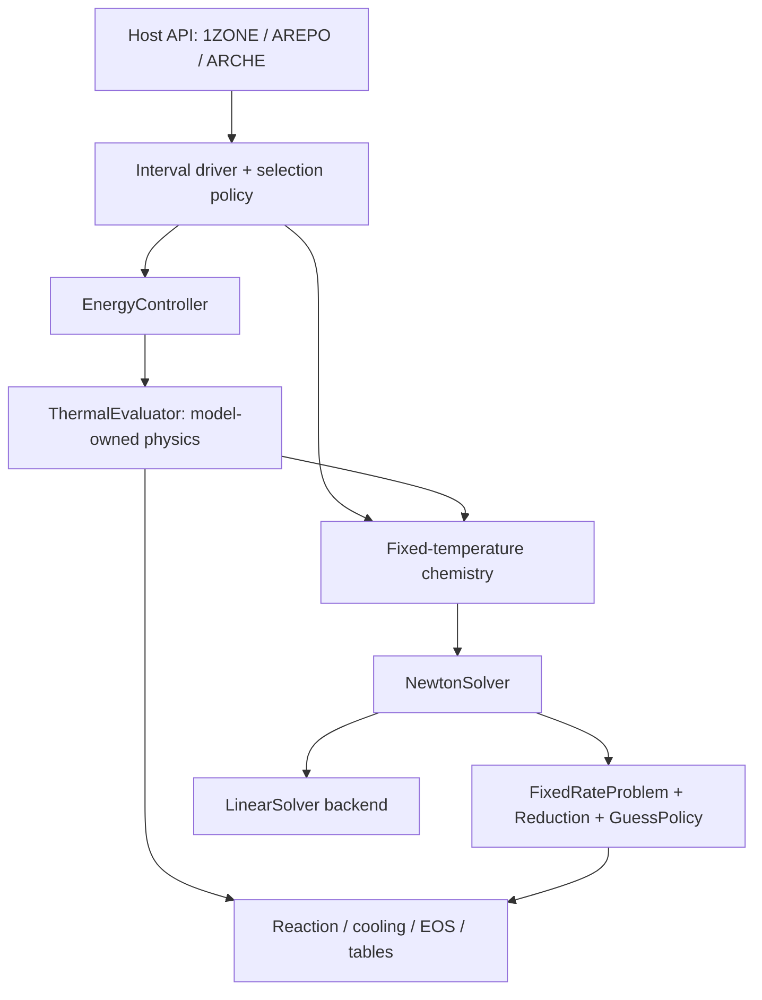

> 過去の照合・検討記録。設計の正本は [C++設計書](chemistry_cpp_arche_design_2026-09-28.md)。この記録中の拡張版の実装は互換性要件ではない。

# 1ZONEのC++化とARCHE mainへの接続を考慮した設計案

2026-09-28。ソース照合に基づく設計案。実装変更・数値実験・新たなpushは行っていない。

## 結論

既存の寿命別データ分離を保ち、**数値制御、物理モデル、時間進行方針、ホスト接続**を分ける。
主目的は**現在の1ZONEをC++化すること**。その際、ARCHE mainの物理実装へ接続しやすい
境界を設け、可能なら数値制御を共通solverにする。数値処理の基準は現在の1ZONEとする。
ARCHE拡張版は未使用の実験的・過渡的な実装であり、接続の一例としてのみ参照する。
そのclass構成、API、挙動の維持、試験通過、変更の完了は、本作業の要件にしない。

まず1ZONE内部の依存を整理し、ARCHE mainのRHS・Jacobian・保存則・冷却・EOSとの接続契約を確認する。
energy controllerを最初の数値制御の切り出し候補とするが、拡張版にclassがあることを理由に
実装順序や構造を決めない。Newton、Contextの所有権管理、外側driverの整理は別段階とする。
初回移行で物理式、ネットワーク、線形解法、時間積分方針を一緒に変更しない。

## 1. 参照版と証拠の範囲

- 1ZONE: `/Users/j/Desktop/codex/1ZONE`、`main`、`782d710`。
- AREPO: 前回統合した `feature/1zone-chemistry`、`f7d751c3e4`。
  今回の詳細照合は同じ共有コアを持つ1ZONE側で実施した。
- ARCHE: `/Users/j/Documents/Codex/2026-09-10/referenced-chatgpt-conversation-this-is-an/work/arche-dev`、
  `solver/onezone-integration`、HEAD `aea2f2c`。**多数の未コミット・未追跡の移植ファイルを含む作業ツリー**。
  HEADだけでは今回の参照内容を再現できない。
- [参照manifest](chemistry_cpp_arche_reference_2026-09-28.json)に、照合対象のSHA-256を記録した。
  作業中のARCHEを変更せず、一時スナップショットを作って照合した。
  manifestは内容の識別用であり、ソースそのものの保存や再取得を保証するものではない。

以下、`O:` は1ZONEルート、`A:` は上記ARCHEルートからの相対パス。
行番号は参照スナップショットのもの。過去の設計書だけでなく、現在の呼び出し経路を確認した。
ARCHEの古い `.dev/solver-update-design.md` は置換済み文書なので、現行仕様の根拠にしない。
`.dev/implicit-solver-port-design.md` も、その後に変わった実装についてはコードと区別する。

これは静的照合である。「差がある」は確認済みだが、各差の実計算への影響・性能は今回測定していない。

### 1.1 設計対象と参考実装の区別

ローカルで確認した `main` と `origin/main` はともに `aea2f2c`
（2026-09-05、release 1.1.0後のコメント修正）。リモートの最新をfetchした確認ではない。
`solver/onezone-integration` のHEADも同じだが、実装差は未コミット・未追跡ファイルにある。
そのためHEAD比較だけでは拡張の有無を判定できない。

| 比較対象 | 確認した構造 | 設計での位置付け |
|---|---|---|
| ARCHE main (`git show main:...`) | `solve/` は `chemistry.h`, `chemreact.h`, `conservation.h`。`core/newton.h` に `newton_solve<N, LinSolve, Residual, Update>`。`ARCHE_SUBCYCLE` の条件分岐も存在 | 1ZONE由来拡張を前提にしない接続先。必要な変更量を別途評価する |
| ARCHE拡張版（作業ツリー） | `implicit_port::NewtonEngine`, `EnergyController`、全dt方式、任意のHeブロック消去など | 実験的な接続例。互換性・回帰維持の対象ではなく、必要なら設計ごと捨てられる |

2・3節の拡張版の照合記録は参考資料であり、要件ではない。
全dt方式や追加controller、Heブロック消去をmain本来の要件として扱わない。
mainの従来solverと同じ数値結果を、新solverへの置換だけで保証するものでもない。

共通solverの成立条件は、1ZONEで現在の数値処理を維持しながら、ARCHE mainの物理実装へ
明示的な評価器で接続できること。拡張版への接続は成立条件に含めない。
mainへ拡張版の型・driver一式を先に移植することも条件にしない。
共有の可否はenergy制御、Newton制御、外側driverの各層で別々に判断する。
mainの存在する型・入口は確認済みだが、物理評価ごとの詳細な接続契約の照合は未完了である。
以下のclass案は、その確認で修正し得る設計仮説として扱う。

## 2. 現在の呼び出し構造

### 1ZONE / AREPO

```text
AREPO adapter -> chemistry_advance (public C API)
                               -> chemistry_core_advance
standalone legacy adapter ----> chemistry_core_advance / 個別solver入口
                                     |
                          solver選択・内部subcycle
                              /                \
                 fixed-T chemistry       implicit energy
                                             |
                                          evaluate_g
                                             |
                          chemistry + cooling + thermodynamics
```

公開C APIはローカル状態へコピーし、成功時だけ呼び出し元へ反映する
(`O:src/chemistry/interface/chemistry_api.c:214`)。
一方、standaloneには個別solverを直接呼び出して状態をexportする入口もある。
公開APIの失敗時保証が全ての内部・legacy入口にある、と仮定してはいけない。

### ARCHE拡張版（参考記録）

```text
chem_full_step -> advance_port -> solver選択 / 同じdtでのfallback
                          /                         \
                advance_explicit           advance_port_implicit
                                                  |
                             EnergyController<PortEnergyEvaluator>
                                                  |
                              evaluate_trial / advance_implicit_core
                                                  |
                         solve_chemistry (legacy / block policy)
                                                  |
                              NewtonEngine<..., Physics>

chem_step / chemreact -> fixed-T chemistry
chemcool -> EnergyController<ChemicalEnergyEvaluator> (化学熱のみ)
```

`chemcool` と `chem_full_step` は熱源の範囲が違う。名前の類似だけで統合しない。
`solve_chemistry` は `BlockSolverPolicy::Off/Prefer/Require` で分岐する。
`ChemParams` の既定値はOff。アプリ・呼び出し元が上書きし得るため、Heブロック方式を
全ARCHEの現行標準経路と呼ぶのも不正確である。

## 3. 拡張版との比較記録（互換性要件ではない）

この表は実験版が現1ZONEと同一ではないことを示す記録。
拡張版の修正・同期をC++化の前提作業にしない。保持する挙動は1ZONE側の回帰で検証する。

| 項目 | 1ZONE | ARCHE拡張版 | 比較から分かること |
|---|---|---|---|
| energy二分法での非有限残差 | `solve_bisection` に有限性検査、失敗として戻る処理あり (`solver.c:878`) | `implicit_energy.h:595` ではその検査なしに区間端点を更新 | 後発修正の未反映。有限でない点を区間端点にしないことは共有の必須条件 |
| 従属種の残差の規格化 | 独立種の反応活動量を保存則の逆写像で伝播した `implied_gross` を考慮 | `implicit_control.h:193` 以降は当該項を持たない | 後発修正差。式と対応する回帰を揃える対象 |
| Newton残差の受理閾値 | `CHEMISTRY_NEWTON_RESIDUAL_GATE_LIMIT=1e3`、上書き可能 (`solver.c:1870`) | `implicit_newton.h:136` は1 | 数値方針の版差。機械的に緩和せず、モデル別回帰付きで採否を判断 |
| energy探索の温度上限 | 主探索 `T_max=1e6 K` | `implicit_energy.h:107` は `3e6 K` | モデルの有効域・探索方針の設定。言語移行に混ぜて統一しない |
| 区間の進行 | driverにsubcycle、高温経路、残時間管理あり | 指定dt全体を成功させるか失敗。内部時間分割なし | 意図的な契約差。外側の時間進行層へ置く |
| Hybrid選択 | 冷却・化学時間と密度の条件を使用 | 現コード `solver_selection.h:26` は化学時間だけでexplicit/chemistry implicitを選び、不適格なら同じdtでenergyへ | 単に「密度条件だけが違う」ではない。選択規則を別方針として保持 |
| 線形解法 | LAPACK、構成によりLU再利用 | `NewtonEngine::solve` にEigenの動的行列とLUが直接埋め込まれている | 線形代数を内部backendへ分離。初回は各実装を維持 |
| モデル固有の縮約 | 元素・電荷保存則、構成依存の中間種の扱い | 保存則に加え、任意でHeの条件付き線形BEブロックを消去 | 汎用NewtonにHeを埋め込まない。モデル側のreductionとして渡す |
| 候補の保持 | state/workspaceコピー、`commit`フラグ | `EnergyPoint`とPayload、ただし仮のC型・commitフラグも残る | 候補と作業領域を分け、評価と採用を明示 |
| 外部組成 | 主に `n_i/(rho/m_p)`、Newton入口でper-Hへ変換 | `n_i/nH` | 永続状態を無理に統一しない。方程式の規格化を契約に含める |
| energyの熱源 | 加熱正の体積率 `rhoU_dot` | 冷却正の比率 `Lambda_net` | 評価器内で符号・単位を吸収。探索器には統一した残差を返す |

拡張版のenergy試験は `tests/implicit_energy.cc` でC参照実装との試行列を比較している。
有用な構造だが、参照の `tests/reference/onezone_control/energy_bisection.inc` も
非有限残差の修正前であり、`energy_main.inc` の上限も3e6 Kである。
**移植元スナップショットとの一致は、現在の1ZONEとの一致や不具合の不存在を意味しない。**

## 4. 推奨する責務の分離



依存の境界を表した図であり、新しい公開外部solver製品を要求するものではない。
共有ライブラリ化かソース取り込みかは後で判断する。拡張版で採った配布・依存方針も拘束条件にしない。
評価器は接続側の小さな実装とし、ホスト全体の型やdriverの変更を必要としないことを目標とする。

### 4.1 EnergyController: 1ZONEから切り出す候補

担当は温度候補の生成、区間の保持、根探索、continuation、反復予算。
密度、金属量、化学種名、EOS、光源、冷却式、C形式の仮workspaceを持たせない。

1ZONEのenergy探索と `evaluate_g` の依存を起点に、候補・区間・結果型を設計する。
拡張版のEvaluator方式は分離の一例であり、そのclassや仮workspaceを移植する必要はない。
初回は現在の1ZONEの探索順と非有限残差への保護を保ち、構造変更と数値変更を分ける。

評価器は、構築時に `y0`, `u0`, `dt`, 環境、モデル設定を固定する。
各温度の候補は必ずこの初期状態から解く。隣接温度の解を渡すのは初期推定としてだけ。
推定値で物理的初期状態や化学加熱の基準状態を置き換えない。

推奨契約（C++17の概念案。既存APIではない）:

```cpp
// EvaluationScratchは呼び出し専有。保持済みの候補を参照しない。
using TrialResult = std::variant<ValidTrial, RejectedTrial, FatalError>;
TrialResult evaluate(Temperature, const Guess*, EvaluationScratch&);

// 収束候補からモデル固有の最終整合性検査を経て作る。
AcceptResult accept(ConvergedTrial&&, HostState&);
```

- `ValidTrial`: 有限な温度・エネルギー・残差と候補payload。単なる評価成功であり収束とは別。
- `RejectedTrial`: 非収束など、その温度候補を棄却して別候補へ進める理由。
- `FatalError`: 入力/テーブル/評価の異常など、この区間の探索を中断する理由。
- 区間の端点として保持できるのはValidTrialのみ。根が端点そのものの場合も明示処理する。
- `ConvergedTrial`: 探索の終了条件を満たした候補。最終受理検査とは分ける。
- 採用前に状態全体を検査し、成功時だけhostへ反映する。

これらの型は、検証済みの生成関数やprivateコンストラクタで作る。
publicな数値フィールドとvariantを置くだけでは、有効性は保証されない。
NaNは診断情報には残せるが、制御状態の唯一の表現にはしない。

参考例として拡張版はcontinuation用のcore組成と、split後の最終payload組成を別に持っている
(`chemistry.h:613, 626`)。両者は意味が違うので単一の配列へ短絡的に統合しない。
この具体的な分割を必須にせず、推定値と採用候補を同じ状態と仮定しない境界を検討する。

拡張版の `donor_accepted/host_accepted` は移植検証用であり、製品の型名にはしない。
内部では `search_converged` と `candidate_accepted` の意味を区別し、診断には双方を残す。
巨大な残差を除外する閾値1e6を、通常のエネルギー収束精度と呼ばない。

### 4.2 NewtonSolver: アルゴリズムと一回のsolve状態

1ZONEの `ChemNewtonSystem`、反復制御、線形解法の現在の分離から、次の組合せを検討する。
ARCHE mainの物理評価を接続するために必要な操作を確認して、具体的な契約を確定する。

```text
NewtonSolver<Problem, LinearSolver>
  solve(const Problem&, InitialGuess, NewtonWorkspace&, NumericalOptions)
    -> NewtonResult

Problem (一回の固定T・固定dtの問題)
  物理y0、化学加熱用y0、保存量、固定反応係数、境界
  RHS / gross production-loss / Jacobian / 従属変数の再構成

NewtonWorkspace (一回のsolveが専有)
  反復組成、未知数一覧、chart、補正、行列、LU、反復履歴、RNG
```

`Problem`は変更可能なworkspaceへの隠れた参照を持たず、外側の温度試行をまたいで
固定反応係数が更新されることもない。保持すべき量は所有し、大きなrun tableはconstで借りる。
これは1ZONEの内側Newtonで係数を固定する現在の契約を型に表すものとする。

chart変更は、従属種、未知数一覧、微分写像、LUの無効化、該当履歴リセットを
一つの操作にする。LU再利用の判断規則は移行時に変えず、その規則が前提とする
問題・chart・係数・dtが変わったら確実に無効化する。毎反復の組成変化だけで全て無効化すると
現行の修正Newtonの再利用方針を変えてしまうので避ける。

物理モデルの関数を何十個も一つの万能Physicsへ足すのは避ける。
まず内部で `Kinetics`, `Reduction`, `GuessPolicy` に責務を分け、solverからは
それらを束ねたProblemを使う。深い継承より合成を基本とする。
初回からあらゆるクラスをテンプレート化せず、実際に両実装が必要とする境界だけに置く。

### 4.3 ReductionとLinearSolverは別

Reductionは「どの変数を解き、消去した変数がどう応答するか」を定義する。
まず1ZONEの保存則・中間種の処理を扱い、ARCHE mainの保存則との接続を確認する。
拡張版のHeブロック消去は実装対象に含めない。将来別の消去方式を加える場合は、
物理仮定と応答微分をその方式の契約として扱う。

LinearSolverは、既に構築された行列の分解・求解・有効性だけを担当する。
1ZONEはLAPACK、ARCHEはEigenを維持して差を切り分ける。
行列アクセスの数学的意味を `J(i,j)=∂f_i/∂y_j` と明文化し、既存の転置や
column-major格納への変換は境界で扱う。初回移行で格納順・計算順まで変えない。

拡張版の `MatrixXd` / `VectorXd` の構成を移植する必要はない。
後段でスレッド/呼び出し専有の再利用バッファを検討し、確保回数を測定する。
89種など大きいモデルもあるため、全行列の固定長スタック化を既定にしない。

### 4.4 外側driverと方針

共通化の粒度は「指定された一つのdtを解く操作」。時間分割はその外に置く。

- 1ZONE/AREPO: 現在の高温経路、残時間・subcycle、密度依存選択を保持するIntervalDriver。
- ARCHE main: main側の入口・時間進行を確認し、共有するsingle-step操作との接続箇所を選ぶ。
  拡張版の全dt方式を前提にしたAtomicStepDriverを必須にしない。
- solver fallbackと時間分割は別の操作として表す。
- 固定Tの化学更新と、EOSを含む熱化学更新を別の入口として維持する。
- 密度進化・圧縮仕事・MPI・粒子の保存形式はhost側。

`SelectionPolicy`（解法の選択）、`NumericalOptions`（許容誤差・予算）、
`ModelValidity`（有効温度域・状態検査）を混ぜない。
有限性、初期状態の保持、失敗時の非反映は切替可能なpolicyにしない。

残差閾値1/1e3や探索温度上限は、根拠と版を持つ設定として記録する。
1ZONEのC++化では現1ZONEの値を基準にする。拡張版の値の維持は不要。
mainへの接続時に変更が必要なら、別の数値変更として根拠と検証を付ける。

### 4.5 Context・状態・C境界

- `ChemistryContext`: run資源をRAIIで所有。コピー不可。評価時は読み取り専用。
- `State`, `Environment`, `EvaluationSummary`: 通常の値型structを基本にする。
- `EvaluationScratch`: 計算中だけ利用。候補payloadへその参照を残さない。
- `Candidate`: 採用に必要な組成、熱状態、history、冷却加熱・dust/opacity情報を保持。
- 診断・計数は物理状態と分け、棄却候補の情報も保持できるようにする。

Context全体や化学種の並びをARCHEと同一にする必要はない。
公開C APIは維持し、C++の型・例外・Eigen/HDF5をC ABIへ出さない。
温度と比内部エネルギーのどちらを永続状態にするかも各ホストの契約を保つ。

既存 `chemistry_workspace_init` はcaller提供のraw storageを `memset` して使用する。
非自明なC++オブジェクトをここへ単純に置けない。初期移行ではC互換の単純なstorageを維持するか、
明示的な構築・破棄を備えた新たなopaque workspace APIを追加する。
後者なら既存呼び出し元、alignment/size取得、ABI versionを含めて別変更として扱う。
例外があり得る初期化はC境界でstatusへ変換し、通常の非収束は例外ではなく結果型で返す。

## 5. C++機能を使う範囲

- C++17を基準案とする。ARCHEは既にCMakeで17を要求する。AREPO運用環境は別途確認。
- templates: Evaluator、Problem、LinearSolverと実際の固定次元。反応ごとのvirtual classは作らない。
- class/private: 資源所有、初期状態の固定、chartとLUの整合性、有効候補の生成。
- struct: 入出力とコピーして隔離する状態。全フィールドへのgetter/setter追加はしない。
- `enum class`: 解法、失敗理由、化学種ID。数値と化学種indexを区別する。
- `std::array`: 小さな固定長の値。大きなscratchの配置は測定して決める。
- `std::variant`: 型の異なる試行結果。C++23の `std::expected` を必須にしない。
- `constexpr`: 種メタデータと定数・整合性検査。runtimeロードする反応表を無理に静的化しない。
- Observer: 型付きイベントによる診断。無効時のコストと有効時の出力責務を切り分ける。

C++化による速度向上は未確認。主目的は、現在は注意事項で守っている所有権・状態遷移を
型と操作で表すこと。熱いループでの仮想呼び出し、追加確保、無用な候補コピーを増やさない。

## 6. 回帰・受入条件

### A. 数値制御だけの試験

現在の1ZONE C実装を固定し、C++版と同じ評価関数を与えてtraceを比較する。
拡張版のfake evaluator試験は手法の参考にできるが、その旧参照との一致は要求しない。

1. 通常の根、端点の根、区間外候補、化学非収束、fatal評価、continuation。
2. 二分法の中点だけが棄却される例: 無効残差が区間端点にならず、偽収束もしない。
3. どの試行・初期推定でもy0/u0/dtが不変、失敗後の再試行も元状態から始まる。
4. chart変更・回復後のLUと反復履歴、guess/restart順序と乱数再現性。
5. 従属種の残差に独立種のgross scaleを伝播する例。閾値1/1e3とは独立に検証。

制御だけを同じ評価器で比較する試験は、試行順・statusの一致を要求する。
物理backendや線形backendが違う試験に、同じNewton反復数やbit一致を要求しない。

### B. モデル・線形代数の契約

- RHS、gross production/loss、解析Jacobianと縮約Jacobianの整合性を検査する。
- Jacobianの行列向き・保存則消去・ブロック応答を小問題で独立に検査する。
- energyの符号と単位: 1ZONEでは `g=u-u0-dt*rhoU_dot/rho`、
  ARCHEでは `g=u-u0+dt*Lambda_net`。化学熱を二重計上しない。
- 輸出floor、保存量修正、split sourceなどの最終処理後も受理契約が成り立つことを確認。
- 同じ物理入力の比較に必要な種・rate・EOSが揃わない場合、両モデルの出力一致を主張しない。

### C. ホスト回帰

- 1ZONEのenergy replay 4ケース。特にgate=1で試行失敗を強制するケースを維持。
- ARCHE mainへの接続試験: mainの固定T/熱化学入口と対象モデルについて、
  反応率・EOS・冷却・状態変換の契約を検証する。新solverによる数値結果の変化は別途評価する。
- 拡張版のblock policy、solver mode、過渡的なAPIの回帰維持は受入条件にしない。
- AREPO C adapterのコンパイル・リンクと、実運用構成でのbuild/replay。
- 1ZONEの初期化回帰3件の失敗は前回、統合前にも再現した既存問題。
  基準との差を記録し、移行後の新しい失敗と混同しない。
- 性能は評価回数、Newton回数、行列構築/分解回数、確保回数、経過時間を分ける。
  反復数の変化と実装速度の変化を混同しない。

## 7. 実装順序と共有ソースの扱い

1. **1ZONEとmainの契約確認・回帰の準備**: 現在の1ZONEを数値的な基準として固定し、
   ARCHE mainの物理評価に必要な型・単位・状態・呼び出し順を照合する。
   拡張版の確定や同期を待たず、mainへ接続する最小例を設計する。
2. **C++混在ビルド**: 1ZONE/AREPOのC APIにC++ linkage対応。Cライブラリ・LAPACK境界も確認。
   配列/ABIを維持して、後の個別置換を可能にする。単なる拡張子変更を完成としない。
3. **energy controller（切り出し候補）**: 1ZONEの数値処理をC++化し、物理評価を分離する。
   1ZONE回帰を通し、ARCHE mainの評価器で接続境界を検証する。拡張版は依存先にしない。
4. **Newton**: 固定問題とworkspaceを分離し、線形backendとreductionの契約を整える。
   最初は既存の計算順を保つ。その後chart/LUの操作をclassに閉じ込める。
5. **資源所有・driver**: ContextのRAII化とstandalone入口を整理。
   外側の区間進行は各仕様を維持したまま、single-step操作を利用する形へ移す。
6. **型と性能**: メタデータのconstexpr化、配列ビュー、バッファ再利用などを測定付きで進める。

共有方式の推奨は、狭い数値制御部分について単一の正本を持ち、必要なら版を固定して
各リポジトリへ取り込む方式。ただし配布方法は接続の実証後に判断する。
共有ライブラリ等も含め、拡張版の配布方針には拘束されない。公開API・物理モデルまで統一しない。

正本を置く場所は実装抽出時に確定する。初回から新規独立リポジトリやパッケージを必須にしない。
独立編集するコピーを増やさず、取り込み元の版・hash・数値設定と共通回帰を記録する。
1ZONE/AREPOの現parity checkerは `.c/.h` 対象なので、C++導入時に `.cc/.cpp/.hpp` と
必要な共有設定にも対応する。数値設定が意図的に異なるARCHE全体にbyte一致は要求しない。

## 8. 次の実装で確定する事項

- ARCHE mainの接続対象版と、RHS・Jacobian・保存則・冷却・EOSの具体的な契約。
- mainの物理実装を使う最小接続例で、1ZONE由来の仮の型やdriverを持ち込まずに済むか。
- 最初のC++workspaceは単純なstorageを保つか、新APIで構築・破棄を管理するか。
- AREPO本番コンパイラのC++17対応と最終リンク方法。
- 共通数値制御の正本の配置と取り込み手順。

いずれも設計を具体化する作業であり、現時点でソース統合や物理仕様変更の完了を意味しない。
