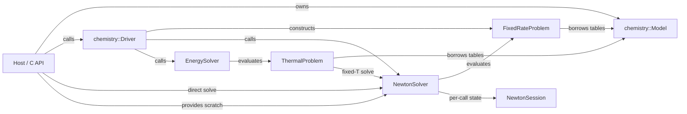

> 2026-09-29 配置更新: 小分けのディレクトリを集約した。
> 現在の配置と実際の呼び出し順は
> `/Users/j/Desktop/codex/1ZONE/src/chemistry/README.md` を正本とする。
> API・driver・初期化・Model所有・共通定義はモジュール直下。
> FixedRateProblemはFixedRateSolverと同じヘッダ・実装に統合、
> BE組み立てとLAPACKはsolver内のlinear_algebraのヘッダ・実装に統合。
> 以下の旧配置案は到達先の必須要件ではない。classの独立性は維持する。

# 1ZONE chemistryのC++設計

2026-09-28 / 設計案。数値実装は未変更。基準は1ZONE `782d710`。
工程1のC/C++混在ビルドとC API境界は実装済み。
[実装・検証記録](chemistry_cpp_stage1_2026-09-28.md)を参照。
工程2のModel所有権・読み取り専用viewも実装済み。
[工程2の記録](chemistry_cpp_stage2_2026-09-28.md)を参照。
固定T Problem・NewtonSession・反復ループのC++化も実装済み。
[工程3の記録](chemistry_cpp_stage3_2026-09-28.md)を参照。
接続先の評価はARCHE **mainのコミット `aea2f2c`** を直接読んで行った。
ローカルのmain参照であり、リモート最新版をfetchしたものではない。
[参照manifest](chemistry_cpp_arche_reference_2026-09-28.json)に対象ファイルのSHA-256を記録する。

## 1. 目的と設計上の決定

目的は現在の1ZONEの数値処理を保ってC++化し、ARCHE mainなどの別の物理実装に接続しやすくすること。
将来、可能なら共通solverとして利用できる設計にする。今回の実装・検証対象は1ZONEと既存のAREPO接続に限る。
ARCHEへの接続実装・接続検証・ARCHE側の変更は今回行わず、C++化の完了条件にも含めない。
ARCHE拡張版は過渡的な実験であり、接続の参考例に留める。
そのAPI、全dt方式、Heブロック、回帰、配布方針を維持する要件はない。

決定案:

1. 所有権・状態の整合性をclassで表す。物理式と単純な値は関数・structとして残す。
2. 数値制御を `numerics`、化学・熱物理とモデル選択を `chemistry` に分ける。
3. 化学、energy、区間進行を別の入口にする。外側driver一式の移植を必要としない。
4. 共有部分には種名・固定種数・1ZONEのContext・AREPOのデータ型を持ち込まない。
5. C++17を基準案とし、公開C APIとAREPOのCコードを維持する。
6. 初回は1ZONEの計算順、閾値、初期推定と回復順序、LAPACK、subcycleを維持する。
   これらの改善は、構造変更とは別の数値変更として行う。
7. ARCHE mainの調査結果は、種・状態・単位・物理評価をsolverへ埋め込まないための設計資料としてのみ使う。

共通solverとは共通の数値制御を使うことを指す。物理モデルや最終結果が等しいことではない。
ARCHE mainの旧solverとのbit一致を、新solverへの交換の受入条件にしない。

## 2. ARCHE mainを直接確認して分かった接続条件

以下のARCHEパスは全て `aea2f2c` のgit objectを指す。作業ツリーの同名ファイルは別物である。

| 必要な処理 | mainの入口・データ | 接続上の判断 |
|---|---|---|
| 温度・初期組成に対する反応係数 | `models/rate_kernel.h:49` `compute_base_rates<Model>` | 利用可能。組成依存のparamsとmuを初期状態から用意し、一回の内側Newtonでは固定する |
| RHS・Jacobian・反応flux | 同 `:558` `compute_rates<Model>` | 利用可能。row-major Jacobianとsolver側の格納方式を境界で対応させる |
| gross生成・消滅率、項数 | 上記APIはRHS・Jacobian・varのみを出力 | 追加の評価機能が必要。差し引き済みRHSからgross量を復元してはいけない |
| 元素・電荷保存量 | `kinetics/topology.h:171` `ReactionTable`、`solve/conservation.h:357` `fill_invariants` | 保存則の行は再利用可能。未知数の選択と従属種の復元は別途必要 |
| 事後保存量補正 | `solve/conservation.h:380` `project` | Newton内の縮約の代替ではない。電荷は絶対中性、元素は入力からの増分を補正する意味を持つ |
| 化学加熱・冷却 | `solve/chemreact.h:69` `compute_chemistry_cooling` | 候補組成と初期組成との差、dt、係数を揃えて呼ぶ |
| EOS | `thermo/eos.h:28,57,61,70` | 組成からmu、gamma、比内部エネルギーを評価できる。1ZONEのEOSを持ち込まない |
| 化学の旧solver | `solve/chemreact.h:214` `chemreact` | 固定T化学への接続候補。実際のNewtonループはここにあり、`core/newton.h` の汎用 `newton_solve` を交換するだけでは置換できない |
| `chem_step` | `solve/chemistry.h:130`、内部で`chemcool`を呼ぶ | 単純な固定T solverの別名ではない。公開入口名だけで契約を推定しない |
| 全冷却加熱 | `solve/chemistry.h:183` `chem_full_step` | 組成を更新して各熱源率を返す。連成energy更新の入口としてそのまま呼べない |
| 外側のenergy更新 | `src/apps/common/collapse_driver.h:123` | `de=-Lambda_net*dt+圧縮仕事`を外側で適用する。連成energy solverを入れる場合、この更新との二重計上を避ける契約変更が必要 |

特に重要な制約:

- mainの`chem_full_step`はline/continuum評価、化学、保存量補正、LW/X-ray分割処理を含む。
  そのまま新energy solverの残差関数に入れると、旧solverの二重呼び出しや評価順の変更を招く。
- metalのcontinuum計算はローカルなgrain温度を更新し、それを反応係数に渡す。
  温度試行間でこの状態を共有せず、評価の依存順を明示する必要がある。
- 反応表には特殊なgrain反応や、通常のproduct配列に収まらない追加生成物がある。
  gross量を汎用の反応表走査だけで実装すると、実際のkernelと一致しない可能性がある。
- mainの`converged`フラグと1ZONEの残差認証の意味は同じではない。
  既存のフラグを新solverの収束証明に流用しない。

従って「小さなwrapperを書けば全て接続できる」とは現時点で言えない。
将来接続する際には、不足する評価情報と物理時間積分の契約変更を検討する。今回それらを実装する必要はない。

配布上の制約もある。mainの `CMakeLists.txt:75` 以降は公開facadeのヘッダだけをinstallし、
物理kernelの内部ヘッダはinstallしない。将来の接続ではソースとともにコンパイルする方式等の検討が必要になる。
既存の公開C/C++ APIだけでRHS等を外から呼べるとは仮定しない。
製品として接続する際はARCHE側に接続用のコンパイル単位を置き、必要なモデルだけ明示的に
実体化する方式を候補にする。ホスト利用者へ内部kernelヘッダを要求しない形を検討する。

## 3. モジュールと所有関係



Model、solver、driverは独立したモジュールであり、driverが他の二つを所有する構造ではない。
図のcalls/evaluatesは利用関係を示す。Problemはsolverを所有せず、solverがProblemを評価する。
ホストはdriverを通さずに固定T solverを直接利用できる。
現在の実装は化学専用の `chemistry::FixedRateSolver` で、汎用 `NewtonSolver` は後続工程。


共有候補は`NewtonSolver`、`EnergySolver`と、それらの小さな値型・作業型。
1ZONEの物理実装とdriverもC++化するが、共有を強制しない。
共有solverの依存方向は型で渡される問題へ向け、物理モデルから数値制御への不要な循環を作らない。

| 型の案 | class/struct | 所有・寿命・保証 |
|---|---|---|
| `chemistry::Model` | class | run全体のnetwork・各tableをRAIIで所有。コピー不可。初期化成功後は物理評価に対して読み取り専用 |
| `StepEnvironment`, `CellEnvironment` | struct | sweep/cellの入力。計算にはconstで渡す |
| `CellState` | struct | 1ZONEの組成・比内部エネルギー・gamma。候補として値コピー可能 |
| `chemistry::Driver` | class | Modelをconst参照。区間進行とsolver選択を統括。共有の可変cell/workspaceをメンバに持たない |
| `FixedRateProblem` | class | 一回の固定T・固定dtの問題。物理y0、加熱用y0、係数、保存量・boundsを固定する |
| `NewtonSession` | class | 一回のsolveの反復状態。chart・未知数一覧・LU有効性・履歴の連動を管理する |
| `NewtonScratch<N>` | struct | 行列・ベクトルの作業領域。一回の同時呼び出しが専有。候補と一緒にコピーしない |
| `ThermalProblem` | class | energy探索区間の初期状態・dt・環境を固定し、温度候補を評価する |
| `ThermalCandidate` | 値型＋検証済み生成 | 有効な温度・残差・採用候補。scratchへの参照を残さない |
| `SolveReport`, `EvaluationSummary` | struct | 成否の理由、残差、回数など。物理状態と診断を分離 |

型名は案だが、寿命と依存の境界はこの形を基準とする。
classにする対象は資源を持つものか、複数の値の整合性を保つもの。
`Reaction`, `Cooling`, `EOS`をそれぞれ巨大なclassにすることは要求しない。
純粋な物理式はnamespace内の関数として残す。

Modelのconst参照だけでthread safetyが成立するとはしない。既存のprofile・診断・初期化時static状態は別途監査する。
Modelを参照するdriver/problemよりModelが長生きする。借用後のModel移動を避けるため、
初期版ではModel本体のcopy/moveを禁止し、factoryが所有ハンドルを返す方式を採る。

## 4. 共有solverが要求する契約

### 4.1 固定T chemistry / Newton

1ZONEのNewton内部と同じく、初期実装のsolver座標は `y_i=n_i/nH` とする。
1ZONEの外部組成 `n_i/(rho/m_p)` はchemistryの入出力境界で一度だけ変換する。
ARCHE mainの組成は既にper-Hなので、その変換は不要。密度・rateのnH依存も評価側に閉じ込める。

概念API（名前と型引数の細部は実装時に確定する）:

```cpp
// ProblemによりNと各評価型が決まる。反応数・種名はsolverには不要。
template<class Problem, class LinearBackend>
class NewtonSolver {
public:
    NewtonOutcome<typename Problem::State>
    solve(const Problem& problem,
          const typename Problem::Guess* guess,
          NewtonScratch<Problem::species_count>& scratch,
          const NewtonOptions& options) const;
};
```

`Problem`は次の責務を持つ。物理評価、制約、推定を内部で合成し、継承の階層は作らない。

| 操作 | 入出力・制約 |
|---|---|
| 問題の構築 | `y0`, `dt`, T、環境から固定係数と保存目標を作る。通常のguess補正でy0を変更しない |
| `evaluate_kinetics(y, request, out)` | RHS `f`、gross生成P、gross消滅L、丸め誤差評価用の項数、必要時Jacobian。P/Lは非負のabundance/timeで、Lは消滅係数ではない |
| 制約情報の供給 | 元素・電荷行、目標値、bounds、消去可能な種の情報。H/He/D/C/O固定配列を要求しない |
| `reconstruct` / `linearize_constraints` | 独立変数から全組成を復元し、その応答をJacobianへ含める。中間種の物理仮定を保持する |
| 初期推定・回復候補 | 現1ZONEでは既存のレシピ・RNG順序。別モデルにはその種名を要求せず、別のGuessPolicyを渡す |
| 出力検査 | 有限性・非負性・保存量など。モデル固有のfloor処理を共有solverに埋め込まない |

P/Lは差し引き前の反応寄与に基づく。`P=max(f,0)`, `L=max(-f,0)` は不適切。
またnet RHSの総和順や補償和を変えることは単なる型変更ではないので、初回の1ZONEでは保持する。

保存目標は各モデルの契約で決める。ARCHE mainの電荷行は絶対中性であり、
単純に全行を`C*y0`へ置き換えない。物理入力の前処理と、Newtonの初期推定の修正を分ける。
mainへの初回接続で、1ZONE固有のC/O pivotやrestart recipeを移植する必要はない。
不足する制約・推定戦略は将来の接続側の課題とし、今回の実装範囲へ持ち込まない。

`NewtonSession`がchart変更を受け付ける操作は、一度に以下を更新する:

1. 従属種、独立未知数の一覧、応答写像。
2. LUの無効化と、現アルゴリズムで必要な収束履歴のリセット。
3. chartに依存する作業配列の有効範囲。

LUの再利用規則自体は既存の修正Newtonを維持する。全ての組成更新でLUを無効化する設計にはしない。
新しい問題・dt・固定係数・chartへ移った場合は必ず無効化する。

線形backendの契約は `factorize(matrix)` / `solve(rhs)` / 明示的な失敗結果。
数学的な行列は `J(i,j)=df_i/dy_j` とする。row-major / column-majorは境界のviewで指定し、
初回は1ZONEのLAPACKと行列構築順を保つ。Eigen採用をC++化の必須条件にしない。

### 4.2 energy探索

1ZONEの `evaluate_g` が持つ物理評価を `chemistry::ThermalProblem` に切り出す。
`EnergySolver`が知るのは温度、残差、探索区間、推定値、反復予算、成否だけ。
種数・density・EOS式・冷却式・1ZONEのworkspace全体を要求しない。

```cpp
template<class ThermalProblem>
class EnergySolver {
public:
    EnergyOutcome<typename ThermalProblem::Candidate>
    solve(const ThermalProblem& problem,
          typename ThermalProblem::Scratch& scratch,
          const EnergyOptions& options) const;
};

// ThermalProblem側の概念的な操作
TrialOutcome<Candidate> evaluate(Temperature temperature,
                                const Guess* guess,
                                Scratch& scratch) const;
```

`TrialOutcome`はC++17のvariantなどで `ValidTrial`, `RejectedTrial`, `FatalError` を区別する。
有限であることを検査して生成したValidTrialだけを区間端点にできる。
有効な評価、根探索の収束、モデルとしての最終受理は別の段階として扱う。
値がpublicなstructをvariantに入れただけでは検証済みにならないため、生成経路を限定する。

- 探索中は `y0`, `u0`, `dt`, 環境を固定。近隣温度の解はguessとしてだけ使用する。
- 各trialは同じ初期状態から化学と必要な物理を評価する。試行間の可変状態共有は禁止する。
- 候補を棄却しても、熱源やhistoryを次の候補へ加算しない。診断カウンタは別に保持する。
- 候補組成と初期推定の型を同一と決めつけない。ただし実需のないpayload階層は作らない。
- 成功候補の反映は上位driverが行う。失敗時には呼び出し元の物理状態を変更しない。
- 1ZONEのenergy残差は `g=u-u0-dt*rhoU_dot/rho`。ARCHEの冷却率を使う場合は
  `g=u-u0+dt*Lambda_net`。符号・単位は問題側で吸収する。

現在の探索順、continuation、非有限残差への保護、温度上限1e6 Kを1ZONEの基準にする。
モデルの有効域と探索設定は将来の接続時に別途検討する。実験版の3e6 Kに合わせる理由はない。

### 4.3 driver

`chemistry::Driver`は現在の `chemistry_core_advance` の責務を次の操作へ分ける。

```text
prepare_environment -> estimate_timescales -> select_plan
  -> advance_one_step(plan, dt)
  -> validate_and_accept
  -> update_remaining_interval
```

高温経路、固定温度処理、密度閾値、subcycleの判断は現1ZONEの意味と順序を保つ。
上位の `advance_interval` は開始状態の候補コピーへ更新し、全区間の成功時だけ公開状態へ反映する。
legacy入口の失敗時exportなど、現在の公開C APIと異なる挙動は入口ごとに確認し、暗黙に変えない。

他のコードは `NewtonSolver`だけ、`EnergySolver`まで、または1ZONEのdriverまでのいずれも利用できる。
独自の時間刻みを使うコードへ、1ZONEのsubcycleや拡張版の全dt方式を要求しない。
化学solverの回復と、時間刻みを分割する操作を区別する。

## 5. 将来拡張として残す事項（今回の実装・検証対象外）

ARCHE mainへの接続を将来検討する際には、次の事項がある。
今回必要なのは、これらを後から扱える依存境界を保つことまでとする。

- mainの反応係数・RHS・Jacobianを利用する評価器。
- gross生成・消滅率、保存則の縮約、モデル別初期推定の不足を埋める処理。
- mainの冷却・EOSを利用する温度試行の評価器。
- energyを更新する入口と、熱源率だけを返す入口の区別、および外側の更新との二重計上防止。
- LW/X-rayの分割処理、grain温度、遮蔽、圧縮仕事との組合せ。

接続用class、検証用checkout、試験、配布形態は今回作成・確定しない。
将来接続する時点のmainを改めて調査し、別作業として範囲を決める。

## 6. ABI・メモリ・配置

- C++公開facadeは `chemistry::Model` と `chemistry::Driver`。C APIは従来のopaque handleとCGSデータを維持する。
- `extern "C"` とC++最終リンクを整える。AREPO全体をC++でコンパイルしない。
- table所有はRAII。初期化失敗はstatus付きfactoryから返し、部分初期化資源を自動解放する。
- 通常の非収束は例外にしない。C++内で例外が起き得る処理はC境界でstatusへ変換する。
- 大きなmatrixやbackendの資源を候補状態に入れない。同時呼び出しごとのscratchに配置する。
- 初回は既存のstack/固定配列方式を保てる範囲で移す。大規模ネットワーク向けの事前確保方式は
  コンテキストの初期化/worker準備で行い、必要容量不足を呼び出し中の隠れた確保で補わない。
- 現C APIのworkspaceはcallerのraw storageを `memset` する方式。そこへ所有ポインタや非自明な
  destructorを持つ型をそのまま入れない。初回は単純なstorageと分離したC++ sessionで維持する。
  C++オブジェクトの構築が必要ならplacement constructionとalignmentを明示する。
  非自明な所有workspaceが必要になった時点で、create/destroyを持つ別APIを追加する。
- `Model`やテーブルはshared_ptrで一律に共有しない。所有者一つとconst借用を基本にする。
- 固定種数は `N_SP` のグローバルmacroから共有solverへ漏らさず、問題の次元として渡す。
- `std::array`、enum class、namespace、限定したtemplateを使う。反応ごとのvirtual objectは作らない。
- 大規模な単位ライブラリは導入しない。境界の型・命名・文書でCGSと組成規格化を明示し、必要な
  Temperature/SpecificEnergy等の小さな型を段階的に加える。

配置案（現在のソース対応を保ちながら段階的に移す）:

```text
src/chemistry/
  include/chemistry/          既存C API + C++ facade
  numerics/                  newton / energy / result / matrix views
  model/                   model / driver / chemistry_problem / thermal_problem
  reaction_network/          現在の反応・種データと物理関数
  cooling/ thermodynamics/   現在の物理関数
  adapters/arepo/             Cのホスト接続
  tests/                     1ZONE回帰・共有solverの契約試験
```

初回からファイル移動と数値変更を同じ差分にまとめない。上記は到達先の配置案。
数値制御の正本は1ZONE内の `numerics` とする。外部へ共有する配布方式は将来の課題であり、
今回のC++化をその決定に依存させない。

## 7. 実装順序と受入条件

| 段階 | 成果物 | 完了条件 |
|---|---|---|
| 0: 基準・ビルド | 固定したC版、設定manifest、C/C++混在ビルド | C APIとAREPO adapterのコンパイル・リンク、既存replayを再現 |
| 1: 寿命と値型 | ModelのRAII化、状態・作業領域の型、driverの入口分離 | 初期化失敗・破棄・独立Contextが正しく動作。数値回帰に新規差なし |
| 2: 固定T Newton | 現1ZONEの反復制御をC++化、問題/制約/backend境界を実装 | clipping、chart変更、LU再利用、restart、残差認証の比較と1ZONE回帰 |
| 3: energyとdriver | 現1ZONEのenergy制御のC++化、外側の区間進行を整理 | energy replay全4ケース、棄却候補・continuation、単位/符号・全区間反映の検証 |

この順序は1ZONE内部の寿命管理、固定T化学、energy、区間進行の依存関係に基づく。
ARCHEへの接続が成立することを各段階の完了条件にしない。

数値制御だけを同じ評価器・backendで比較する試験では、反復・trial順と成否を比較する。
1ZONEの物理回帰では同じbuild設定で温度・組成・残差を比較し、bit差があれば原因を確認する。
1ZONE自身の保存量・非負性・BE残差・時間刻み収束を必要に応じて確認する。
別モデルとの比較は今回の検証範囲に含めない。

1ZONE既存のenergy replayはgate=1で化学失敗を強制するケースも維持する。
前回、統合前にも再現した初期化回帰3件の失敗は基準上の既存問題として記録し、全試験成功と報告しない。
新たな失敗や既存失敗の変化は個別に調べる。

性能は同一条件で、反応評価回数、Newton回数、LU分解回数、確保回数、時間を分けて測る。
C++化自体による高速化は約束しない。初回の目標は数値契約を保ちながら、所有権・依存を明示すること。

## 8. 次の実装着手点

C/C++混在ビルド、Modelの所有権管理、固定T ProblemとNewtonSessionの分離は実装済み。
さらに、BE行列組み立てとLAPACK backendを種・化学型に依存しない `numerics` に分離した。
詳細は [工程4](chemistry_cpp_stage4_2026-09-28.md) を参照。
次は固定Tの制約・chart操作と反復制御の境界を明確にし、汎用NewtonSolver化へ進む。
現時点ではFixedRateSolverはchemistry固有で、energy solverとdriverはCのままである。

ARCHEのcheckout・編集・ビルド・接続検証は今回行わない。

[過去の拡張版との比較記録](chemistry_cpp_arche_comparison_2026-09-28.md)は参考資料として分離した。
その記録のclass案や互換性議論は、本書の要件に優先しない。
