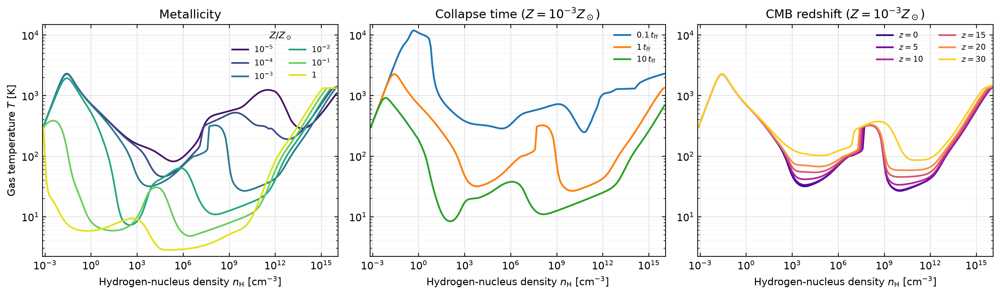
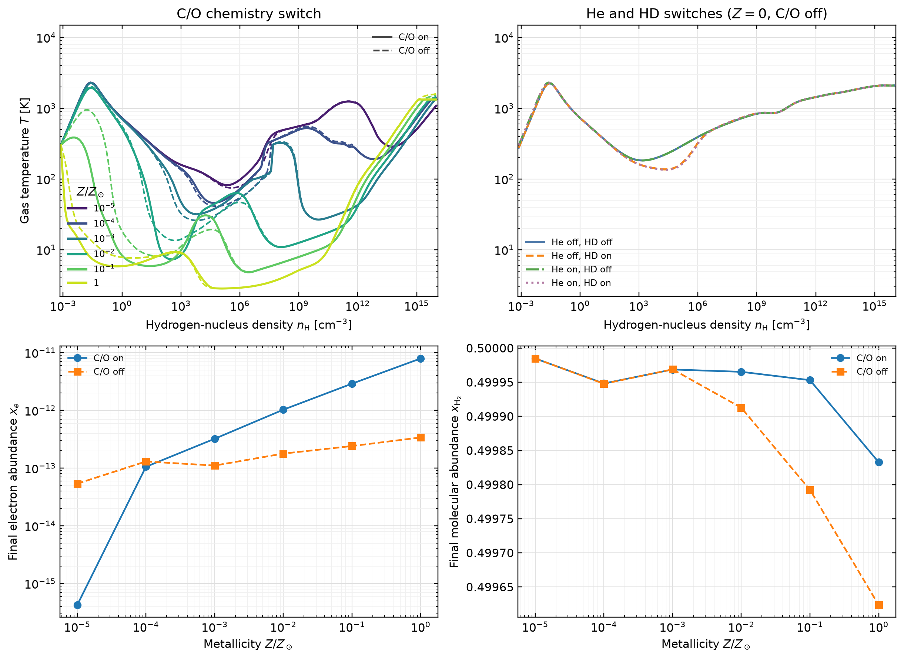
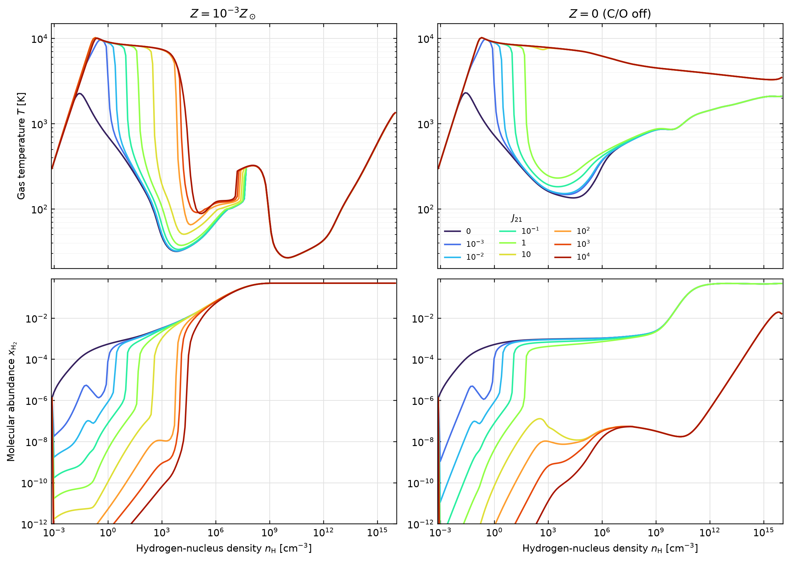
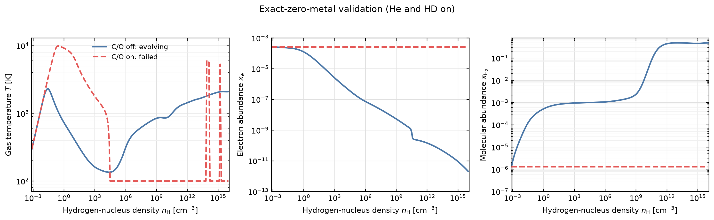

# One-zone parameter validation (2026-09-11)

## Source and common setup

- Repository: `/Users/j/Desktop/codex/1ZONE`
- Starting commit: `a86657551f58a44bae18d358c844785fa6c0aa1f`
- Compiler optimization: `-O2`
- Initial hydrogen-nucleus density: `7.6e-4 cm^-3`
- Maximum hydrogen-nucleus density: `1e16 cm^-3`
- Initial gas temperature: `300 K`
- Implicit energy and chemistry integration
- Full-implicit equilibrium-intermediate initialization
- Newton LU reuse enabled
- C/O conservation enabled whenever C/O chemistry is compiled
- No timestep shortening was used to hide chemistry failures

The trajectory files use `n_H = 0.76 * column 1`, gas temperature in column 2,
`x_e = n_e/n_H` in column 11, and `x_H2 = n_H2/n_H` in column 17.

The LW runs use the existing type-B spectrum and H2 self-shielding.  The
validation added `ONEZONE_J21_INDEX` and expanded the standalone LW survey to

`J21 = 0, 1e-3, 1e-2, 1e-1, 1, 10, 100, 1000, 10000`.

The existing `SLOW_COLLAPSE` convention is inverse to the requested collapse
time: `SLOW_COLLAPSE=10` gives `t_coll=0.1 t_ff`, no definition gives
`t_coll=t_ff`, and `SLOW_COLLAPSE=0.1` gives `t_coll=10 t_ff`.

## Validation matrix

| Suite | Fixed conditions | Varied conditions | Trajectories |
|---|---|---|---:|
| Nonzero-metal feature matrix | `z=0`, `J21=0`, `t_coll=t_ff` | `Z/Zsun=1e-5...1`, C/O on/off, He on/off, HD on/off | 48 |
| Exact-zero feature matrix | `Z=0`, `z=0`, `J21=0`, `t_coll=t_ff` | C/O on/off, He on/off, HD on/off | 8 |
| Collapse time | `Z/Zsun=1e-3`, C/O/He/HD on, `z=0`, `J21=0` | `0.1, 1, 10 t_ff` | 3 |
| CMB temperature | `Z/Zsun=1e-3`, C/O/He/HD on, `J21=0`, `t_coll=t_ff` | `z=0,5,10,15,20,30` | 6 |
| LW at nonzero metal | `Z/Zsun=1e-3`, C/O/He/HD on, `z=0`, `t_coll=t_ff` | nine J21 values | 9 |
| LW at zero metal | `Z=0`, C/O off, He/HD on, `z=0`, `t_coll=t_ff` | nine J21 values | 9 |
| **Total** | | | **83** |

## Acceptance checks

- All 83 processes exited with status 0.
- No `CHEM_SURVEY_FAILURE`, chemistry failure, or energy failure was printed.
- Every trajectory contains 202 density samples and reaches
  `n_H >= 9.7e15 cm^-3`.
- Temperature, electron abundance, and H2 abundance are finite and
  nonnegative at every sample.
- For C/O-off runs, the largest residuals visible at the ten-digit output
  precision are:
  - hydrogen nuclei: `1.46e-11`
  - helium nuclei: `4.98e-13`
  - deuterium nuclei: `9.19e-16`
  - charge neutrality: `9.80e-15`
- Compiling LW support with `J21=0` gives output bitwise identical to the
  corresponding build without LW support.
- Selecting `ONEZONE_J21_INDEX=8` gives output bitwise identical to the
  `J21=1e4` member of the complete nine-point survey.

The process status alone is not sufficient: four exact-zero-metal C/O-on runs
are physical validation failures, as described below.  Therefore 79 of 83
trajectories pass both numerical and physical-evolution checks.

## Validation figures



The metallicity sequence (left), collapse-time sequence (center), and CMB
redshift sequence (right) show the full temperature-density trajectories.  The
curves recover the expected ordering: enhanced cooling at higher metallicity,
hotter evolution for faster collapse, and a rising low-temperature floor with
CMB redshift.



Solid and dashed curves in the upper-left panel compare C/O chemistry on and
off at each nonzero metallicity.  The other panels isolate the He/HD switches
and compare the final electron and H2 abundances.  C/O chemistry has little
thermal influence at the lowest metallicities but changes the high-density
trajectory and final charge balance at higher metallicity.



The LW sequence shows both temperature and H2 abundance for
`Z=1e-3 Zsun` (left) and exact zero metallicity with C/O off (right).  Increasing
J21 delays molecular formation.  At nonzero metallicity the tracks later
return to a similar dust-cooled molecular endpoint, whereas the zero-metal
strong-field branch remains substantially less molecular.



This comparison makes the four physical-validation failures visible.  With He
and HD on, the C/O-off trajectory evolves normally, while the C/O-on trajectory
keeps both `x_e` and `x_H2` exactly at their initial values and develops
temperature excursions despite returning process status 0.

The figures can be regenerated from a validation output tree with:

```sh
python3 docs/plot_onezone_parameter_validation.py \
  /private/tmp/chem_validation_a866575/output \
  docs/figures/onezone_parameter_validation_2026-09-11
```

## Metallicity sequence

These runs have C/O, He, and HD enabled, with `z=0`, `J21=0`, and
`t_coll=t_ff`.

| Z/Zsun | Tmin [K] | Tmax [K] | Tfinal [K] | xe,final | xH2,max | xH2,final |
|---:|---:|---:|---:|---:|---:|---:|
| 1e-5 | 82.000 | 2307.31 | 1087.96 | 4.25e-16 | 0.499985 | 0.499985 |
| 1e-4 | 45.996 | 2303.64 | 1403.18 | 1.05e-13 | 0.499984 | 0.499948 |
| 1e-3 | 26.703 | 2267.37 | 1343.51 | 3.22e-13 | 0.499986 | 0.499969 |
| 1e-2 | 7.315 | 1941.80 | 1349.11 | 1.03e-12 | 0.499994 | 0.499965 |
| 1e-1 | 4.808 | 1330.17 | 1330.17 | 2.90e-12 | 0.499998 | 0.499953 |
| 1 | 2.830 | 1330.19 | 1330.18 | 7.93e-12 | 0.500000 | 0.499833 |

The minimum temperature decreases systematically with metallicity.  At solar
metallicity and `z=0`, the minimum is close to the 2.73 K CMB temperature.

## C/O chemistry on/off

These runs have He and HD enabled.  Atomic metal and dust physics remain
compiled in the C/O-off cases; the switch changes the explicit C/O reaction
network and its molecular cooling.

| Z/Zsun | C/O | Tmin [K] | Tmax [K] | Tfinal [K] | xe,final | xH2,final |
|---:|:---:|---:|---:|---:|---:|---:|
| 1e-5 | off | 74.847 | 2307.41 | 1088.26 | 5.37e-14 | 0.499985 |
| 1e-5 | on | 82.000 | 2307.31 | 1087.96 | 4.25e-16 | 0.499985 |
| 1e-4 | off | 41.289 | 2304.67 | 1404.21 | 1.30e-13 | 0.499948 |
| 1e-4 | on | 45.996 | 2303.64 | 1403.18 | 1.05e-13 | 0.499948 |
| 1e-3 | off | 25.982 | 2277.69 | 1345.76 | 1.11e-13 | 0.499969 |
| 1e-3 | on | 26.703 | 2267.37 | 1343.51 | 3.22e-13 | 0.499969 |
| 1e-2 | off | 10.948 | 2040.83 | 1455.38 | 1.78e-13 | 0.499913 |
| 1e-2 | on | 7.315 | 1941.80 | 1349.11 | 1.03e-12 | 0.499965 |
| 1e-1 | off | 4.840 | 1539.37 | 1539.37 | 2.41e-13 | 0.499792 |
| 1e-1 | on | 4.808 | 1330.17 | 1330.17 | 2.90e-12 | 0.499953 |
| 1 | off | 2.839 | 1603.75 | 1603.75 | 3.39e-13 | 0.499624 |
| 1 | on | 2.830 | 1330.19 | 1330.18 | 7.93e-12 | 0.499833 |

The two switches remain close at low metallicity but differ materially at
`Z >= 1e-2 Zsun`, as expected when molecular C/O cooling and charge carriers
become dynamically relevant.

## He and HD on/off

| Z/Zsun | He | HD | Tmin [K] | Tmax [K] | Tfinal [K] | xe,final | xH2,final |
|---:|:---:|:---:|---:|---:|---:|---:|---:|
| 0 | off | off | 183.068 | 2248.96 | 2101.38 | 5.72e-12 | 0.481459 |
| 0 | off | on | 136.763 | 2249.01 | 2101.11 | 2.08e-12 | 0.481474 |
| 0 | on | off | 182.824 | 2307.68 | 2101.44 | 2.07e-12 | 0.481452 |
| 0 | on | on | 134.943 | 2307.72 | 2101.11 | 2.08e-12 | 0.481474 |
| 1e-3 | off | off | 26.688 | 2207.86 | 1344.60 | 3.25e-13 | 0.499984 |
| 1e-3 | off | on | 26.703 | 2207.91 | 1343.51 | 3.22e-13 | 0.499969 |
| 1e-3 | on | off | 26.688 | 2267.33 | 1344.60 | 3.25e-13 | 0.499984 |
| 1e-3 | on | on | 26.703 | 2267.37 | 1343.51 | 3.22e-13 | 0.499969 |

At zero metallicity HD lowers the temperature minimum by about 46--48 K.
At `Z=1e-3 Zsun`, metal/dust cooling dominates the minimum and the HD effect
is small.  Helium mainly changes the low-density thermal peak; the high-density
endpoint remains consistent.

## Collapse-time sequence

These runs use `Z=1e-3 Zsun` with C/O, He, and HD enabled.

| tcoll | Tmin [K] | Tmax [K] | Tfinal [K] | xe,final | xH2,max | xH2,final |
|---:|---:|---:|---:|---:|---:|---:|
| 0.1 tff | 248.171 | 11952.3 | 2301.37 | 2.36e-13 | 0.498425 | 0.447280 |
| 1 tff | 26.703 | 2267.37 | 1343.51 | 3.22e-13 | 0.499986 | 0.499969 |
| 10 tff | 8.420 | 913.803 | 669.714 | 6.03e-14 | 0.499996 | 0.499985 |

The ordering is physically consistent: rapid collapse leaves less time for
cooling and H2 formation, while slow collapse reaches lower temperatures and
a more molecular endpoint.

## CMB-redshift sequence

These runs use `Z=1e-3 Zsun`, C/O/He/HD on, `J21=0`, and `t_coll=t_ff`.

| z | TCMB [K] | Tmin [K] | Tmax [K] | Tfinal [K] | xe,final | xH2,final |
|---:|---:|---:|---:|---:|---:|---:|
| 0 | 2.73 | 26.703 | 2267.37 | 1343.51 | 3.22e-13 | 0.499969 |
| 5 | 16.38 | 27.482 | 2267.59 | 1345.31 | 3.22e-13 | 0.499968 |
| 10 | 30.03 | 33.677 | 2269.01 | 1359.58 | 3.25e-13 | 0.499964 |
| 15 | 43.68 | 45.383 | 2271.03 | 1389.30 | 3.29e-13 | 0.499954 |
| 20 | 57.33 | 58.518 | 2273.73 | 1420.02 | 3.33e-13 | 0.499938 |
| 30 | 84.63 | 85.808 | 2291.55 | 1472.67 | 3.38e-13 | 0.499895 |

For `z >= 10`, the minimum gas temperature follows just above the CMB floor.

## J21 sequence at Z=1e-3 Zsun

| J21 | Tmin [K] | Tmax [K] | Tfinal [K] | xe,final | xH2,final |
|---:|---:|---:|---:|---:|---:|
| 0 | 26.703 | 2267.37 | 1343.51 | 3.22e-13 | 0.499969 |
| 1e-3 | 26.703 | 9628.92 | 1343.51 | 3.22e-13 | 0.499969 |
| 1e-2 | 26.703 | 10205.9 | 1343.51 | 3.22e-13 | 0.499969 |
| 1e-1 | 26.703 | 10227.8 | 1343.51 | 3.22e-13 | 0.499969 |
| 1 | 26.704 | 10231.4 | 1343.52 | 3.22e-13 | 0.499969 |
| 10 | 26.708 | 10234.0 | 1343.63 | 3.24e-13 | 0.499969 |
| 100 | 26.725 | 10233.0 | 1344.21 | 3.25e-13 | 0.499969 |
| 1000 | 26.753 | 10216.0 | 1346.13 | 3.26e-13 | 0.499968 |
| 10000 | 26.813 | 10108.0 | 1349.98 | 3.27e-13 | 0.499967 |

Even weak LW radiation suppresses the early H2-cooled branch and raises the
low-density temperature peak.  At `Z=1e-3 Zsun`, metal and dust cooling restore
a similar high-density molecular endpoint across the J21 sequence.

## J21 sequence at exact zero metallicity

These runs use C/O off and He/HD on.

| J21 | Tmin [K] | Tmax [K] | Tfinal [K] | xe,final | xH2,max | xH2,final |
|---:|---:|---:|---:|---:|---:|---:|
| 0 | 134.943 | 2307.72 | 2101.11 | 2.08e-12 | 0.484876 | 0.481474 |
| 1e-3 | 147.673 | 9791.55 | 2101.11 | 2.08e-12 | 0.484876 | 0.481474 |
| 1e-2 | 151.670 | 10229.5 | 2101.11 | 2.08e-12 | 0.484876 | 0.481474 |
| 1e-1 | 182.540 | 10243.7 | 2101.11 | 2.08e-12 | 0.484876 | 0.481474 |
| 1 | 230.635 | 10244.4 | 2101.11 | 2.08e-12 | 0.484876 | 0.481474 |
| 10 | 300.000 | 10244.4 | 3486.81 | 2.62e-8 | 0.019486 | 0.016392 |
| 100 | 300.000 | 10244.4 | 3486.81 | 2.62e-8 | 0.019486 | 0.016392 |
| 1000 | 300.000 | 10244.4 | 3486.81 | 2.62e-8 | 0.019486 | 0.016392 |
| 10000 | 300.000 | 10244.4 | 3486.81 | 2.62e-8 | 0.019486 | 0.016392 |

The files for `J21=10...1e4` are not bitwise identical, although their extrema
and endpoint values agree at the precision shown.  This is a strong-field
plateau rather than evidence that J21 is ignored.  The transition between
`J21=1` and `J21=10` strongly suppresses the final H2 abundance.

## Physical validation failure: exact Z=0 with C/O compiled

All four exact-zero-metal C/O-on combinations (He on/off and HD on/off) return
status 0 and reach the final density, but both `x_e` and `x_H2` remain exactly
at their initial values throughout the trajectory:

- `x_e = 2.631585e-4`
- `x_H2 = 1.315789e-6`

The temperature subsequently approaches the imposed 100 K lower limit.  The
same exact-zero cases evolve normally when C/O is off.  This demonstrates a
configuration-specific failure rather than a valid physical solution. The
comparison isolates it to compiling the C/O network with exactly zero carbon
and oxygen; a degenerate zero-element conservation chart is the leading
interpretation, but the precise failing operation has not yet been traced.
Until that case is fixed, exact-zero-metal calculations must compile C/O
chemistry off.

## Issues found and corrected during validation

1. LW survey selection: added `ONEZONE_J21_INDEX` and the requested nine-point
   J21 sequence.  This changes only survey control.
2. Survey isolation: `initialize_cells()` now clears the standalone cell before
   assigning each condition.  Previously the first diagnostic sample could
   retain `edot_adia` from the preceding survey trajectory.
3. C/O-off diagnostic bounds: the auxiliary H2 diagnostic read `k[60]` even
   when `CHEM_RATE_COUNT=60`.  It now writes zero when that rate slot does not
   exist.
4. Collapse label formatting: `SLOW_COLLAPSE` is cast to `double` before `%g`,
   so integer macro definitions do not cause variadic-format undefined behavior.

After these changes all validation builds are warning-free, and the repeated
J21 member is bitwise identical whether run alone or as part of the survey.

Raw outputs and build/run logs from this validation are under
`/private/tmp/chem_validation_a866575`.  They are intentionally not committed;
this document records the compact, versioned results.
