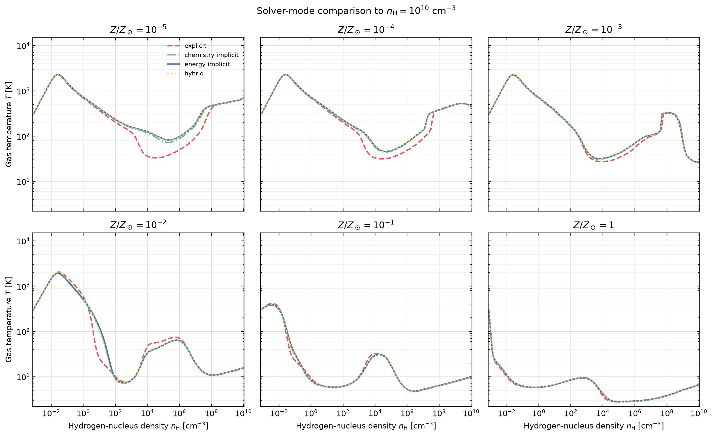
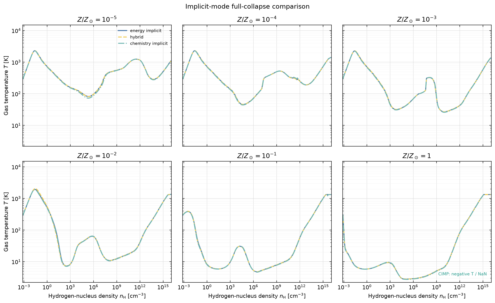

# One-zone solver-mode validation (2026-09-12)

## Setup

- Repository: `/Users/j/Desktop/codex/1ZONE`
- Git HEAD at test start: `f3b7b0d9aa6743fdbf6ea298faaf3fc2b2a2956f`
- The current working tree was tested, including pre-existing uncommitted
  chemistry changes.  The tracked source diff used for the numerical builds,
  before documentation-only additions, had SHA-256
  `81728d941d7fdf3d5f777097807c96ec88de4bf2d8bf17e7d574b1674ea64b71`.
- Compiler optimization: `-O2`
- C/O chemistry, molecular line cooling, He, and HD enabled
- Full equilibrium-intermediate initialization and Newton LU reuse enabled
- `J21=0`, `z=0`, `t_coll=t_ff`
- `Z/Zsun = 1e-5, 1e-4, 1e-3, 1e-2, 1e-1, 1`
- Initial `n_H=7.6e-4 cm^-3`

The solver modes are now configured as follows:

| Mode | User-facing compile definitions | Actual behavior |
|---|---|---|
| explicit | neither implicit definition | chemistry and energy explicit |
| chemistry implicit | `CHEMISTRY_IMPLICIT` | chemistry implicit, energy explicit |
| energy implicit | `ENERGY_IMPLICIT` | chemistry is implied and both are implicit |
| hybrid | `ENERGY_IMPLICIT`, `HYBRID_IMPLICIT` | explicit/implicit selection by local timescales; chemistry is implied |

`chemistry_build_config.h` now defines `CHEMISTRY_IMPLICIT` whenever
`ENERGY_IMPLICIT` is defined.  A binary built with only `ENERGY_IMPLICIT`
produced output bitwise identical to one built with both definitions explicitly.
The same bitwise check passed for two-definition versus three-definition hybrid
builds.

## Common-range comparison

All four modes were run independently to `n_H=1e10 cm^-3`.  Each produced 142
output samples for all six metallicities.

| Mode | Wall time, six tracks [s] | Result through `1e10 cm^-3` |
|---|---:|---|
| explicit | 0.97 | completed; five negative electron samples at `Z=1` |
| chemistry implicit | 1.42 | completed; finite temperature and abundances |
| energy implicit | 1.11 | completed; finite and nonnegative |
| hybrid | 0.78 | completed; finite and nonnegative |

Final temperatures are evaluated at the last output point,
`n_H=(9.57--9.95)e9 cm^-3` depending on mode.

| Z/Zsun | Explicit [K] | Chemistry implicit [K] | Energy implicit [K] | Hybrid [K] |
|---:|---:|---:|---:|---:|
| 1e-5 | 676.996 | 690.179 | 698.453 | 698.454 |
| 1e-4 | 461.852 | 461.407 | 458.325 | 458.325 |
| 1e-3 | 26.584 | 25.959 | 26.701 | 26.701 |
| 1e-2 | 15.641 | 15.228 | 15.631 | 15.631 |
| 1e-1 | 9.942 | 9.679 | 9.943 | 9.943 |
| 1 | 6.795 | 6.652 | 6.822 | 6.822 |

Explicit evolution differs substantially in parts of the trajectory and can
drive trace electron abundance below zero.  Energy implicit and hybrid are
nearly coincident over most of the common interval.  Hybrid differs where its
timescale criteria deliberately select an explicit update; the largest
temperature difference from energy implicit is about 21% for `Z=1e-2`, near
`n_H=25 cm^-3`, while their final temperatures agree to better than `2e-6`
over this limited-density comparison.

## Full-collapse attempt

| Mode | Wall time [s] | Full-density result |
|---|---:|---|
| energy implicit | 2.68 | 6/6 finite, nonnegative tracks |
| hybrid | 1.18 | 6/6 finite, nonnegative tracks |
| chemistry implicit | 1.79 | 5/6 finite; `Z=1` failed |
| explicit | stopped at about 225 s | only `Z=1e-5` completed; `Z=1e-4` was still advancing after about 8.25 million steps |

For `Z=1`, chemistry implicit with explicit energy first reports failure near
`n_H=1.3e15 cm^-3`.  The first invalid output is at
`n_H=1.53e15 cm^-3`, where the gas temperature changes from `1319 K` to
`-3048 K`; the track then contains nine negative-temperature samples and 27
non-finite values.  The log contains 73 `CHEM_SURVEY_FAILURE` records even
though the process exits with status 0.  This is consistent with the explicit
energy update overshooting the positive-energy domain, but the individual
cooling/heating term responsible has not yet been isolated.

The explicit full-collapse run completed `Z=1e-5`.  During `Z=1e-4`, its live
state reached only `n_H=1.42e15 cm^-3` after about 8.25 million steps; the last
fully flushed output row before interruption was at `6.04e14 cm^-3`.  Its
electron abundance was already about `1.5e-89`.  The evidence therefore points
to collapse of the explicit chemistry timestep in a trace-species regime, not
to a nonlinear-solver iteration failure.

Raw output and logs are stored under
`/private/tmp/chem_solver_mode_validation` and are not committed.
