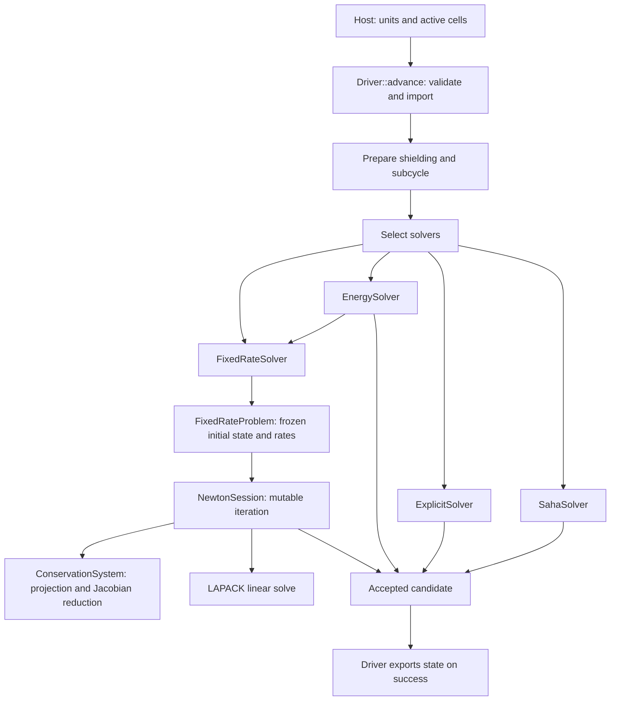

# Chemistry core

The portable implementation is C++17. CHEMISTRY_SC is no longer required;
select the module through its build source list. There is no opaque C context/workspace API
or C compatibility build mode. AREPO and standalone adapters both call native
Model, Driver and solver interfaces. C linkage remains only at actual foreign
boundaries, such as LAPACK and the older AREPO host hooks.

## Physics options and defaults

`/Users/j/Desktop/codex/1ZONE/src/chemistry/chemistry_build_config.h` is the single
source of portable physics defaults. Every physics switch below takes numeric
`0` (disabled) or `1` (enabled); compiler `-DNAME` means `1`. Headers supplied by
hosts must write `#define NAME 1`, not an empty definition, for canonical options.
Unlike the species presence flags, `=0` really disables these physics switches.
Set only overrides, for example:

```sh
make -C /Users/j/Desktop/codex/1ZONE BUILDDIR=build-custom EXEC=1ZONE_custom EXTRA_OPT='-DCHEMISTRY_THREE_BODY_ABEL02 -DCHEMISTRY_H2_COOLING_GP12 -DCHEMISTRY_DUST_COOLING=0'
```

| Option (all prefixed `CHEMISTRY_`) | Default |
| --- | --- |
| `THREE_BODY` | 1 |
| `H2_FORMATION_ON_DUST` | DUST_COOLING |
| `CASE_B` | 1 |
| `MARTIN97` | 1 |
| `THREE_BODY_ABEL02` | 0 |
| `THREE_BODY_FLOW07` | 0 |
| `THREE_BODY_FORR13` | 1 unless another three-body prescription is selected |
| `ENZO` | 0 |
| `O05` | HIRANO |
| `HIRANO` | 0 |
| `DUST_COOLING` | 1 when METALLICITY is defined, otherwise 0 |
| `MOLECULAR_LINE_COOLING` | 1 with carbon/oxygen species, otherwise 0 |
| `METAL_LINE_COOLING_SD93` | 0 |
| `HELIUM_EQ_COOLING` | 0 |
| `HELIUM_COOLING` | 1 with helium species, otherwise 0 |
| `HLINE_COOLING_THIN` | 0 |
| `CONTINUUM_COOLING_MATSUKOBA` | 1 |
| `CONT_OPACITY` | 1 |
| `H2_OPACITY` | 1 |
| `H2_OPACITY_FIT` | H2_OPACITY |
| `H2_COOLING_G15` | 1 unless another H2 cooling prescription is selected |
| `H2_COOLING_GP12` | 0 |
| `H2_PARTITION_EBM1989` | 0 |
| `H2_PARTITION_I87` | 0 |
| `H2_PARTITION_R85` | 0 |

With no partition option selected, use the EBM1989 partition function fitted by
Matsukoba, preserving the previous default (distinct from `H2_PARTITION_EBM1989`).
Conflicting model selections and invalid dependencies fail at compilation.
H2 formation on dust defaults off when dust cooling is explicitly disabled;
requesting it with dust cooling disabled is an error. Explicit helium cooling
settings override its species-dependent default. HIRANO implies O05; ENZO and
O05/HIRANO are incompatible. The Matsukoba switch also selects some reaction
rate fits, as in the existing implementation.

Old presence-only physics names are accepted at the central compatibility
boundary and mean enabled, including empty historical header definitions.
When both spellings occur, the canonical option wins. Use canonical `=0` to
disable an option. The Config.sh importer translates old names to canonical
names and preserves explicit values. Old reaction-table requirement names
remain readable. The archived implementation keeps its historical build flags.
The old `MOLECULAR_LINE_COOLING` Make variable is an input alias for
`CHEMISTRY_MOLECULAR_LINE_COOLING`; both `0` and `1` are supported.

## Execution flow



Read these files in order:

1. `/Users/j/Desktop/codex/1ZONE/src/chemistry/chemistry_core.h` and
   `/Users/j/Desktop/codex/1ZONE/src/chemistry/chemistry_driver.cc`: Driver input
   conversion, validation, step preparation, subcycling and successful-state export.
2. `/Users/j/Desktop/codex/1ZONE/src/chemistry/solver/chemistry_solver.h` and
   `/Users/j/Desktop/codex/1ZONE/src/chemistry/solver/chemistry_solver.cc`:
   EnergySolver, ExplicitSolver, SahaSolver and shared chemistry constraints.
3. `/Users/j/Desktop/codex/1ZONE/src/chemistry/solver/fixed_rate_solver.hpp` and
   `/Users/j/Desktop/codex/1ZONE/src/chemistry/solver/fixed_rate_solver.cc`:
   immutable FixedRateProblem, per-call NewtonSession, options and scratch.
4. `/Users/j/Desktop/codex/1ZONE/src/chemistry/solver/linear_algebra.hpp` and
   `/Users/j/Desktop/codex/1ZONE/src/chemistry/solver/linear_algebra.cc`:
   matrix assembly/factorization backend.

## Ownership and solver contracts

Model owns reaction topology, generated reaction-rate tables, molecular cooling,
dust opacity and continuum/SD93 tables. Factories return ResourceOwner handles;
partial loader failures unwind through destructors. Variable-size reaction
storage uses std::vector; table/index arrays use unique_ptr<T[]> with nothrow
allocation. No core-owned allocation requires a manual free call. Model exposes const borrowed
views whose lifetime ends with Model. The declarations and construction are in
`/Users/j/Desktop/codex/1ZONE/src/chemistry/chemistry_model.hpp` and
`/Users/j/Desktop/codex/1ZONE/src/chemistry/chemistry_model.cc`.

Driver and solvers do not own Model or each other. Every concurrent call needs
its own ChemWorkspace and NewtonScratch. Enabled profiling counters, residual
traces and failure codes are thread-local. Reports describe only the calling
thread; hosts may serialize report output to keep log records together.

All native solver entry points return ChemistryStatus: OK means success;
NOT_CONVERGED, INVALID_ARGUMENT and INCOMPATIBLE_STATE are distinct failures.
The frozen initial state is restored when a fixed-rate solve fails. Driver's
host-value overload commits the caller's abundances/energy only on success.
The low-level internal-state overload is not transactional.

ConservationSystem (also named ChemConservationSystem) owns the selected
reservoirs, elemental/charge totals and inverse dependent matrix. Its methods
build a chart, project abundances, reconstruct algebraic species and reduce a
Jacobian. Constraint storage is private, with read-only accessors for numerical
control. ChemNewtonSystem prepares/initializes its iterate, builds the Jacobian,
updates timescales and exports a converged solution. FixedRateProblem owns an immutable seed/reference; NewtonSession uses
its own chart copy so reservoir reselection does not mutate the problem.
The shared declaration is in
`/Users/j/Desktop/codex/1ZONE/src/chemistry/solver/chemistry_newton_internal.h`.

EnergySolver's private EnergyInput groups environment, prepared step, chemistry
solver selection and duration. ResidualMode distinguishes trial evaluation from
commit and commit-with-report. Continuation points hold local candidate states
and workspaces. ExplicitSolver supports the selected sequential/simultaneous
update; SahaSolver is compiled only when CHEMISTRY_SAHA is enabled.

## Rates, cooling and tables

ReactionRateEvaluator and CoolingEvaluator borrow environment, state and
workspace; they allocate no run resources. Their implementations are in
`/Users/j/Desktop/codex/1ZONE/src/chemistry/reaction_network/reaction_rates.cc` and
`/Users/j/Desktop/codex/1ZONE/src/chemistry/cooling/chemistry_cooling.cc`.
LogGridView and RateTableView provide temperature lookup without owning tables.

ChemReactionNetwork exposes its native members directly; no network forwarding
functions remain. ReactionRateEvaluator returns void because it has no failure
path; solvers and cooling retain their explicit status contracts.

Resource implementations remain beside their data: reaction topology in
`/Users/j/Desktop/codex/1ZONE/src/chemistry/reaction_network/reaction_network.cc`,
molecular tables in
`/Users/j/Desktop/codex/1ZONE/src/chemistry/cooling/molecular_cooling.cc`, dust in
`/Users/j/Desktop/codex/1ZONE/src/chemistry/cooling/dust_cooling.cc`, and continuum
plus optional SD93 tables in
`/Users/j/Desktop/codex/1ZONE/src/chemistry/cooling/cooling_func.cc`.
Species metadata/normalization remain in
`/Users/j/Desktop/codex/1ZONE/src/chemistry/species.cc`.

Config.table_root names the directory containing the tables subdirectory.
Initialization loads all required data; evaluation performs no lazy file I/O.
Feature selection and species layout remain compile-time choices, which must
match between the host and core.

## Host integration and verification

The native calling contract is documented in
`/Users/j/Desktop/codex/1ZONE/src/chemistry/docs/PUBLIC_API.md`; ownership lifetimes
in `/Users/j/Desktop/codex/1ZONE/src/chemistry/docs/CONTEXT_LIFETIMES.md`; AREPO's
single adapter in `/Users/j/Desktop/codex/1ZONE/src/chemistry/docs/AREPO_ADAPTER.md`.
ARCHE/AREPO2 integration is future work and has not been validated here.

From `/Users/j/Desktop/codex/1ZONE`, verification targets include
check-chemistry-cpp, check-chemistry-model, check-chemistry-fixed-rate,
check-chemistry-initialization and check-energy-replay. Module boundary tests run
from `/Users/j/Desktop/codex/1ZONE/src/chemistry` with target check.

The initialization regression covers exact-zero and sub-floor species. Export
floors are heuristic, not physical source terms: if a floored candidate violates
conservation, export uses the converged unfloored state after checking the same
algebraic constraints. In particular, floors cannot create metals at zero
metallicity. Replays separately verify captured energy-integration cases.

The standalone host owns ChemistryStandaloneAdapter instances. Configuration,
units and prepared-step state are per instance; a new configuration invalidates
the previous step. The host value structures and status mapping are preserved.
All production units under the chemistry, standalone and radiation source trees
are now C++17. C test clients and radiation/older-host foreign linkage remain
intentional. Historical implementations under legacy are outside this migration.

When updating from the C source layout, use a fresh build directory or clean
the previous build: generated dependency files can still name removed .c files.

## Build options

The standalone Make variable CHEMISTRY_EXPLICIT_UPDATE accepts SIMULTANEOUS
(default) or SEQUENTIAL and defines CHEMISTRY_EXPLICIT_SIMULTANEOUS or
CHEMISTRY_EXPLICIT_SEQUENTIAL respectively. Selecting both macros is an error.
Before this cleanup the Make default said SEQUENTIAL but emitted no matching
macro, so the C++ solver actually used simultaneous updates. The current default
preserves that numerical behavior; explicitly requesting SEQUENTIAL now works.
Hosts compiling the core directly also get simultaneous updates when neither
macro is defined. This option controls ExplicitSolver, not the Newton predictor.

| Canonical name | Accepted older spelling | Meaning |
|---|---|---|
| CHEMISTRY_ENERGY_BRACKET_FALLBACK | FLAG_BRENT | Enable the bracketed energy-root fallback |
| CHEMISTRY_SAHA_DIAGNOSTICS | DEBUG_CHEMISTRY_SC | Record Saha chemical heating diagnostics |
| STANDALONE_EXTERNAL_RADIATION | CHEM_REPLAY_EXTERNAL_RADIATION | Standalone radiation rates are supplied externally, including non-replay runs |

Species and reaction/cooling model options use CHEMISTRY_ names. Some solver
and host radiation options retain their existing names. Aliases are resolved in the chemistry build configuration
or standalone compatibility header. Legacy implementations retain their own
option spelling. Unused SINK, SPLIT, CMB_HEAT_PROPER and VARIABLE_GAMMA definitions
have been removed from the root build.

The AREPO configuration importer scans C and C++ implementation/header files,
excludes test fixtures, and recognizes both defined(...) and numeric #if options.
Run check-build-options from /Users/j/Desktop/codex/1ZONE to validate the mapping.

Historical binaries, comparison results and legacy implementations are retained
as reference material; they are not linked into the current portable build.

## Species options

| Canonical option | Historical spelling |
|---|---|
| CHEMISTRY_SPECIES_HELIUM | HELIUM |
| CHEMISTRY_SPECIES_DEUTERIUM | HD |
| CHEMISTRY_SPECIES_H2_PLUS | H2_PLUS |
| CHEMISTRY_SPECIES_HD_PLUS | HD_PLUS |
| CHEMISTRY_SPECIES_D_MINUS | DMINUS, HD_MINUS |
| CHEMISTRY_SPECIES_CARBON_OXYGEN | CARBON_OXYGEN_CHEMISTRY |
| CHEMISTRY_SPECIES_CARBON_OXYGEN_HIGH_IONIZATION | CARBON_OXYGEN_HIGH_IONIZATION |

DEUTERIUM enables D, D+ and HD; it does not select only the HD molecule. HD_PLUS
and D_MINUS require DEUTERIUM. Carbon/oxygen high ionization requires the
carbon/oxygen network, which requires METALLICITY. These are presence-based
compiler options: omit an option to disable it, rather than defining it as 0.

Implementation conditionals and reaction-table requirements use canonical names.
The build configuration translates historical compiler spellings in one place;
HD_MINUS was a diagnostic typo referring to D-, not a separate HD- species.
Older reaction tables remain loadable, and the AREPO Config.sh importer emits
canonical names. Reaction species labels and diagnostic output labels are unchanged.

The root Make variable is now CHEMISTRY_SPECIES_CARBON_OXYGEN=0/1 (default 1);
CARBON_OXYGEN_CHEMISTRY=0/1 is retained as an input alias. Other species options
can be supplied through EXTRA_OPT. Archived implementations retain their old
spellings, with the root build translating canonical flags for that branch.

Detailed solver/cooling diagnostics are compiled with `CHEMISTRY_DEBUG=1`
(default: `0`). Output still requires the per-cell/workspace runtime flag
`diagnostics_enabled`; this is not a particle-ID selector. Normal failure
diagnostics remain available without a debug build.

`CHEMISTRY_UPDATE_CORE_LENGTH` is a numeric solver option, default `1`. It recomputes
core length from density and the current trial temperature; `=0` uses the
host-supplied length. The optional Make variable `CHEMISTRY_UPDATE_CORE_LENGTH=0/1` overrides it.
`CHEMISTRY_H2_ROTATIONAL_GAMMA` defaults to `1` and accounts for the low-temperature
H2 rotational transition in the heat capacity. `=0` selects the former alternative;
`GAMMA_NEW` remains an accepted presence-only input alias.
Dust cooling defaults on only when `METALLICITY` is defined. Explicit dust
settings still override this default. Carbon/oxygen chemistry requires
`METALLICITY`; it does not invent a metallicity value. In standalone,
`METALLICITY=0` means solar metallicity, not disabled metal physics.

Metallicity storage and communication are host concerns. Core always reads the
solar-unit value in `ChemistryCellEnvironment::metallicity`. AREPO uses advected
cell metallicity only with METAL_ADVECTION_SC and without CONSTANT_METALLICITY;
otherwise metal-enabled builds supply All.Metallicity. Uniform values are
reconstructed on the receiving rank, avoiding a per-cell communication field.
Neither host macro participates in core solver decisions.

AREPO background radiation takes its blackbody effective temperature directly
from `All.Teff` (kelvin), at initialization and each step. TYPE_B/TYPE_3E4 do
not select the AREPO spectrum; the host must supply a valid temperature.

## Initialization report

After successful `Model::create`, a human-readable report lists resolved species,
reaction prescriptions, cooling/opacity, thermodynamics, solver policy and
diagnostics. It reports model names and on/off states rather than macro names.
The solver section describes the default driver policy, not a fixed solver for
every cell: runtime solver overrides and the high-density Saha switch can change
which solver is executed. Radiation temperatures and cell metallicities are host
runtime inputs, not fixed properties of Model initialization.

`ChemistryConfig::print_configuration` defaults to 1; set it to 0 for silent
construction. AREPO enables it only on rank 0. Failed construction prints no
configuration report. ChemistryConfig's ABI version is 2 after adding this field.

The report also includes radiation/shielding couplings, conservation constraints,
Newton residual threshold, Saha threshold, Jeans temperature limit, table root
and the configured timestep safety factor. Metallicity is labeled as host input;
a per-cell value or runtime radiation temperature is not invented at Model creation.

Chemistry-owned solver, reaction and thermodynamic settings now use CHEMISTRY_
names; old compiler names remain input aliases at the build-config boundary.
Make controls likewise accept their former names as aliases. Host options such
as METALLICITY, LW_RADIATION_LOCAL, IONIZING_PHOTON, RYTR_*, METAL_ADVECTION_SC,
CONSTANT_METALLICITY, CHEM_BALANCE and refinement settings keep their names.

### Chemistry option renames

| Previous input spelling | Canonical spelling |
|---|---|
| `CHEM_DIFF_ANALYTIC` | `CHEMISTRY_DIFF_ANALYTIC` |
| `CHEM_DIFF_NUMERICAL` | `CHEMISTRY_DIFF_NUMERICAL` |
| `CHEM_DISABLE_CARBON_OXYGEN_CONSERVATION` | `CHEMISTRY_DISABLE_CARBON_OXYGEN_CONSERVATION` |
| `CHEM_ENERGY_BRACKET_FALLBACK` | `CHEMISTRY_ENERGY_BRACKET_FALLBACK` |
| `CHEM_EQUILIBRIUM_SPECIES_CONVERGENCE` | `CHEMISTRY_EQUILIBRIUM_SPECIES_CONVERGENCE` |
| `CHEM_EXPLICIT_SEQUENTIAL` | `CHEMISTRY_EXPLICIT_SEQUENTIAL` |
| `CHEM_EXPLICIT_SIMULTANEOUS` | `CHEMISTRY_EXPLICIT_SIMULTANEOUS` |
| `CHEM_FULL_IMPLICIT_EQUILIBRIUM_INITIALIZATION` | `CHEMISTRY_FULL_IMPLICIT_EQUILIBRIUM_INITIALIZATION` |
| `CHEM_INTERMEDIATE_EQUILIBRIUM` | `CHEMISTRY_INTERMEDIATE_EQUILIBRIUM` |
| `CHEM_NEWTON_LU_REUSE` | `CHEMISTRY_NEWTON_LU_REUSE` |
| `CHEM_NEWTON_RESIDUAL_GATE_LIMIT` | `CHEMISTRY_NEWTON_RESIDUAL_GATE_LIMIT` |
| `CHEM_SAHA_DIAGNOSTICS` | `CHEMISTRY_SAHA_DIAGNOSTICS` |
| `CHEM_CO_O2_DEPENDENT_DENSITY` | `CHEMISTRY_CO_O2_DEPENDENT_DENSITY` |
| `ENERGY_IMPLICIT` | `CHEMISTRY_ENERGY_IMPLICIT` |
| `HYBRID_IMPLICIT` | `CHEMISTRY_HYBRID_IMPLICIT` |
| `SAHA` | `CHEMISTRY_SAHA` |
| `INVERSE_REACTIONS` | `CHEMISTRY_INVERSE_REACTIONS` |
| `CMB_HEATING` | `CHEMISTRY_CMB_HEATING` |
| `UPDATE_L_CORE_IN_SOLVER` | `CHEMISTRY_UPDATE_CORE_LENGTH` |
| `JEANS_LENGTH_TMAX` | `CHEMISTRY_JEANS_TEMPERATURE_MAX` |
| `MAX_ITER_CHEM` | `CHEMISTRY_MAX_ITERATIONS` |
| `FIX_TEMPERATURE` | `CHEMISTRY_FIXED_TEMPERATURE` |
| `SET_TMAX` | `CHEMISTRY_TEMPERATURE_MAX` |

## TODO: X-ray radiation

- [ ] Implement a host-independent X-ray radiation evaluator for primary H/He
  photoionization and heating, with an explicit spectrum, intensity, units and
  absorbing column inputs.
- [ ] Add secondary ionization and heating with explicit electron-fraction
  dependence; define how primary and secondary contributions are combined.
- [ ] Feed evaluated rates through the existing chemistry radiation inputs;
  extend the input contract only where necessary, without host globals in core.
- [ ] Validate zero intensity, optically thin/attenuated limits, energy deposition
  and primary/secondary rates against documented reference cases before exposing
  a supported option.

The unsupported standalone `X_RAY` / `X_RAY_2nd` branches and declarations were
removed. Their former option names are not supported settings. Archived legacy
sources are retained as historical reference, not a validated implementation.

Radiation settings use CHEMISTRY_LW_RADIATION,
CHEMISTRY_BACKGROUND_LW_RADIATION and CHEMISTRY_LW_SELF_SHIELDING.
Photoionization uses the AREPO spelling IONIZING_PHOTON. LW_RADIATION_LOCAL
and RYTR_* remain unchanged host settings. Historical names are accepted at
the configuration and reaction-table input boundaries. These switches remain
presence-based: omit them to disable, rather than defining them as zero.

## AREPO2 NG adapter

The NG bridge is kept in three files under
`/Users/j/Desktop/codex/1ZONE/src/chemistry/adapters/arepo_ng`:

- `/Users/j/Desktop/codex/1ZONE/src/chemistry/adapters/arepo_ng/chemistry_arepo_ng.h`: value-only particle storage (`ArepoNgCell`), pointer-free work packets, and the adapter interface.
- `/Users/j/Desktop/codex/1ZONE/src/chemistry/adapters/arepo_ng/chemistry_arepo_ng.cc`: composition/energy conversion, shared Model lifetime, per-rank workspace, local execution and bounded MPI work distribution.
- `/Users/j/Desktop/codex/1ZONE/src/chemistry/adapters/arepo_ng/chemistry_arepo_ng_module.cc`: NG lifecycle, parameters, unit conversion, active-cell gathering, snapshots and result application.

NG is built against the same source tree using `CHEMISTRY_ROOT`; no copied solver,
C API or intermediate forwarding wrapper is required. Its particle contains
abundances, mass-weighted species amounts, metallicity, mass-weighted metallicity,
gamma and a species-network signature. Domain and binary restart storage retain
these values. Ghost primitive refresh and flux packets explicitly carry the new
fields. Refinement transfers species amounts with the existing mass/volume
weights; NG's pre-existing unsupported remote derefinement path remains unsupported.

Hydro transports composition with **first-order upwind** fluxes. Each primitive
update recovers abundances from conserved amounts and solves the existing
chemistry gamma(T) relation for the current internal energy. Pressure, sound speed,
pressure prediction and HLLD energy evaluation use the cell gamma. HLLD uses a
**frozen composition-dependent gamma** in each Riemann problem; this does not
implement a general thermodynamic EOS Riemann solver. Initial temperature and
minimum temperature are converted per cell with that same composition model.

The chemistry sweep uses the actual NG `TimeBin`, not the hydro stability limit
`TimeBinHydro`. This matters for gravity-limited cells and extended restart timelines.
`ChemistryBalanceWork=1` distributes pointer-free batches via MPI_Alltoallv on the
simulation communicator, excluding NG's shared-memory service ranks. Results
return in owner order with 64-bit IDs checked. No changes are applied if any rank
reports a chemistry error. Zero-work ranks participate. `generic_comm` is not used.

Current scope: non-comoving HLLD hydro/MHD using thermal energy. Entropy evolution,
other EOS/cooling/star-formation modules and cosmological drift factors are rejected
rather than evaluated with a fixed gamma. Radiation-rate fields exist in the work
packet, but the NG module currently supplies zero radiation; connecting a transport
or background spectrum is separate work. Multiple-rank **NG host** execution still
requires Linux because of NG's existing shared-memory implementation; the chemistry
MPI adapter itself runs on macOS.

Enable `CHEMISTRY`, `RIEMANN_HLLD` and the desired canonical chemistry options in
NG's configuration. For example, `CHEMISTRY_SPECIES_HELIUM`,
`CHEMISTRY_HYBRID_IMPLICIT`, and `CHEMISTRY_ENERGY_IMPLICIT`. NG's current MHD code
also requires `OUTPUT_CURRENT_DENSITY` in the tested `MHD_INITIALIZE_A_FROM_B` build.
All six module parameters are required in the parameter file:

```text
ChemistryTableRoot /Users/j/Desktop/codex/1ZONE/src/chemistry
ChemistryInitialMetallicity 0
ChemistryInitialIonizedFraction 1e-4
ChemistryInitialMolecularFraction 1e-6
ChemistryCMBTemperature 2.728
ChemistryBalanceWork 0
```

Metallicity is in solar units. Initial fractions are n(HII)/nH and n(H2)/nH;
their sum with twice the molecular fraction must not exceed one. They apply only
to ICs without chemistry fields. Complete chemical snapshots carry
`ChemicalAbundances`, `ChemistryMetallicity`, `ChemistryGamma` and
`ChemistryNetworkSignature`. Custom ICs supplying abundances must supply the matching
signature as well. Binary restarts require the same particle layout and species
network; use snapshots for supported changes in host storage layout.

Example macOS build, using a separate build directory and executable:

```sh
make -C /Users/j/Desktop/codex/arepo2_ng/arepo -j6 build check check_docs \
  CONFIG=/tmp/arepo_ng_chemistry_config.sh \
  BUILD_DIR=/tmp/arepo_ng_chemistry_build EXEC=/tmp/Arepo2_chemistry \
  CHEMISTRY_ROOT=/Users/j/Desktop/codex/1ZONE/src/chemistry \
  CHEMISTRY_LAPACK_LIBS='-framework Accelerate'
```

Use `-llapack -lblas` (the default) or the appropriate vendor libraries on Linux.
Validation commands (MPI must be allowed to open local sockets):

```sh
make -C /Users/j/Desktop/codex/1ZONE/src/chemistry arepo-ng-mpi-check \
  NG_BUILD_DIR=/tmp/arepo_ng_chemistry_build \
  NG_GSL_LIBS='-L/opt/homebrew/opt/gsl/lib -lgsl -lgslcblas' \
  NG_LINALG_LIBS='-framework Accelerate'
python3 /Users/j/Desktop/codex/1ZONE/src/chemistry/tests/run_arepo_ng_smoke.py \
  /tmp/Arepo2_chemistry /tmp/arepo_ng_chemistry_validation
```

The smoke output directory must not exist. The fixture requires numpy/h5py and
an H/He build. It compares uninterrupted, binary-restarted and snapshot-restarted
runs, checks pressure/gamma consistency, composition-dependent temperature floors,
nonzero hydro transport with conserved total metallicity/hydrogen, and rejects a
mismatched network signature.
The MPI test covers 1/2/3 ranks, empty owners, multiple batches, local/balanced
numerical equality, 64-bit IDs and transactional failure. These are integration
checks, not an accuracy/convergence study of multi-species hydrodynamics.


Validation on 2026-09-29: the NG hydro build passed the normal build, option and
documentation checks; the HLLD/MHD variant linked successfully. The MPI adapter
passed all three rank counts. The one-rank integration fixture passed, including
bit-identical final fields across uninterrupted/binary-restarted/snapshot-restarted
uniform runs. Twelve changed NG translation units also passed syntax checks with
chemistry disabled. End-to-end multi-rank NG and refinement evolution remain
unverified here; NG rejects multi-rank runs on macOS before chemistry starts.
