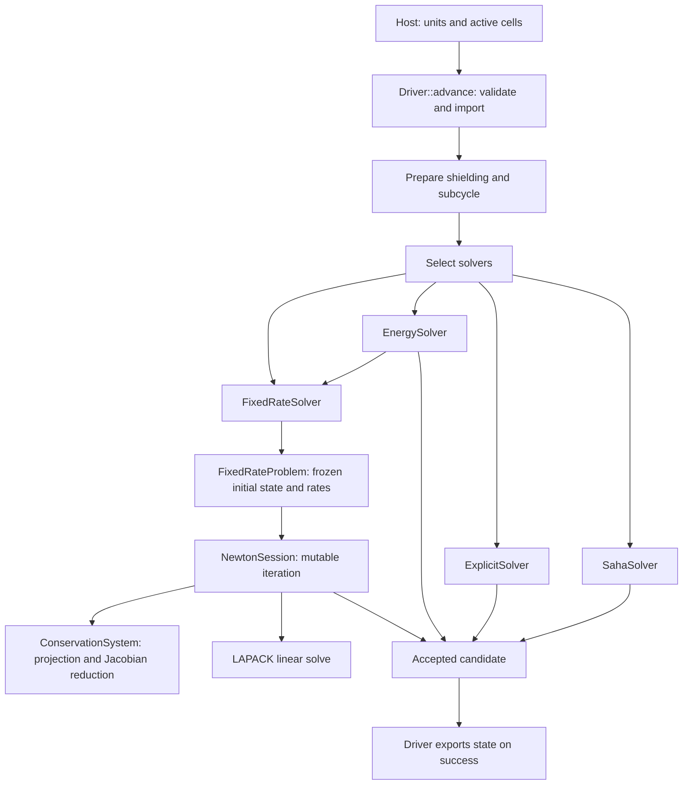

# Chemistry core

The portable implementation is C++17. There is no opaque C context/workspace API
or C compatibility build mode. AREPO and standalone adapters both call native
Model, Driver and solver interfaces. C linkage remains only at actual foreign
boundaries, such as LAPACK and the older AREPO host hooks.

## Execution flow

Read these files in order:

1. `/Users/j/Desktop/codex/1ZONE/src/chemistry/chemistry_core.h` and
   `/Users/j/Desktop/codex/1ZONE/src/chemistry/chemistry_driver.cc`: Driver input
   conversion, validation, step preparation, subcycling and successful-state export.
2. `/Users/j/Desktop/codex/1ZONE/src/chemistry/solver/chemistry_solver.h` and
   `/Users/j/Desktop/codex/1ZONE/src/chemistry/solver/chemistry_solver.cc`:
   EnergySolver, ExplicitSolver, SahaSolver and shared chemistry constraints.
3. `/Users/j/Desktop/codex/1ZONE/src/chemistry/solver/fixed_rate_solver.hpp` and
   `/Users/j/Desktop/codex/1ZONE/src/chemistry/solver/fixed_rate_solver.cc`:
   immutable FixedRateProblem, per-call NewtonSession, options and scratch.
4. `/Users/j/Desktop/codex/1ZONE/src/chemistry/solver/linear_algebra.hpp` and
   `/Users/j/Desktop/codex/1ZONE/src/chemistry/solver/linear_algebra.cc`:
   matrix assembly/factorization backend.

## Ownership and solver contracts

Model owns reaction topology, generated reaction-rate tables, molecular cooling,
dust opacity and continuum/SD93 tables. Factories return ResourceOwner handles;
partial loader failures unwind through destructors. Model exposes const borrowed
views whose lifetime ends with Model. The declarations and construction are in
`/Users/j/Desktop/codex/1ZONE/src/chemistry/chemistry_model.hpp` and
`/Users/j/Desktop/codex/1ZONE/src/chemistry/chemistry_model.cc`.

Driver and solvers do not own Model or each other. Every concurrent call needs
its own ChemWorkspace and NewtonScratch. Profiling counters, when enabled, are
process-wide and require external synchronization for concurrent calls.

All native solver entry points return ChemistryStatus: OK means success;
NOT_CONVERGED, INVALID_ARGUMENT and INCOMPATIBLE_STATE are distinct failures.
The frozen initial state is restored when a fixed-rate solve fails. Driver's
host-value overload commits the caller's abundances/energy only on success.
The low-level internal-state overload is not transactional.

ConservationSystem (also named ChemConservationSystem) owns the selected
reservoirs, elemental/charge totals and inverse dependent matrix. Its methods
build a chart, project abundances, reconstruct algebraic species and reduce a
Jacobian. FixedRateProblem owns an immutable seed/reference; NewtonSession uses
its own chart copy so reservoir reselection does not mutate the problem.
The shared declaration is in
`/Users/j/Desktop/codex/1ZONE/src/chemistry/solver/chemistry_newton_internal.h`.

EnergySolver's private EnergyInput groups environment, prepared step, chemistry
solver selection and duration. ResidualMode distinguishes trial evaluation from
commit and commit-with-report. Continuation points hold local candidate states
and workspaces. ExplicitSolver supports the selected sequential/simultaneous
update; SahaSolver is compiled only when SAHA is enabled.

## Rates, cooling and tables

ReactionRateEvaluator and CoolingEvaluator borrow environment, state and
workspace; they allocate no run resources. Their implementations are in
`/Users/j/Desktop/codex/1ZONE/src/chemistry/reaction_network/reaction_rates.cc` and
`/Users/j/Desktop/codex/1ZONE/src/chemistry/cooling/chemistry_cooling.cc`.
LogGridView and RateTableView provide temperature lookup without owning tables.

Resource implementations remain beside their data: reaction topology in
`/Users/j/Desktop/codex/1ZONE/src/chemistry/reaction_network/reaction_network.cc`,
molecular tables in
`/Users/j/Desktop/codex/1ZONE/src/chemistry/cooling/molecular_cooling.cc`, dust in
`/Users/j/Desktop/codex/1ZONE/src/chemistry/cooling/dust_cooling.cc`, and continuum
plus optional SD93 tables in
`/Users/j/Desktop/codex/1ZONE/src/chemistry/cooling/cooling_func.cc`.
Species metadata/normalization remain in
`/Users/j/Desktop/codex/1ZONE/src/chemistry/species.cc`.

Config.table_root names the directory containing the tables subdirectory.
Initialization loads all required data; evaluation performs no lazy file I/O.
Feature selection and species layout remain compile-time choices, which must
match between the host and core.

## Host integration and verification

The native calling contract is documented in
`/Users/j/Desktop/codex/1ZONE/src/chemistry/docs/PUBLIC_API.md`; ownership lifetimes
in `/Users/j/Desktop/codex/1ZONE/src/chemistry/docs/CONTEXT_LIFETIMES.md`; AREPO's
single adapter in `/Users/j/Desktop/codex/1ZONE/src/chemistry/docs/AREPO_ADAPTER.md`.
ARCHE/AREPO2 integration is future work and has not been validated here.

From `/Users/j/Desktop/codex/1ZONE`, verification targets include
check-chemistry-cpp, check-chemistry-model, check-chemistry-fixed-rate,
check-chemistry-initialization and check-energy-replay. Module boundary tests run
from `/Users/j/Desktop/codex/1ZONE/src/chemistry` with target check.

The initialization regression covers exact-zero and sub-floor species. Export
floors are heuristic, not physical source terms: if a floored candidate violates
conservation, export uses the converged unfloored state after checking the same
algebraic constraints. In particular, floors cannot create metals at zero
metallicity. Replays separately verify captured energy-integration cases.
